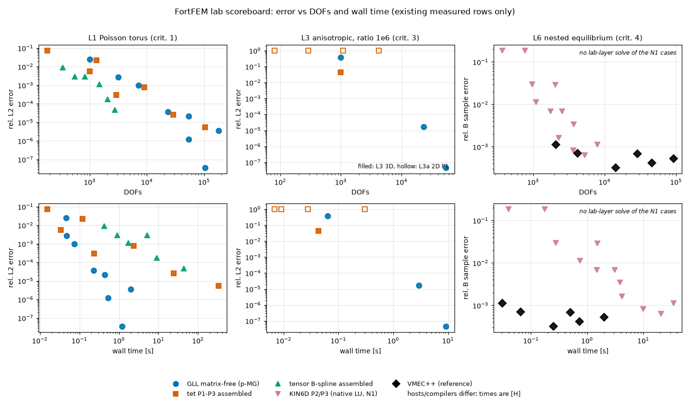
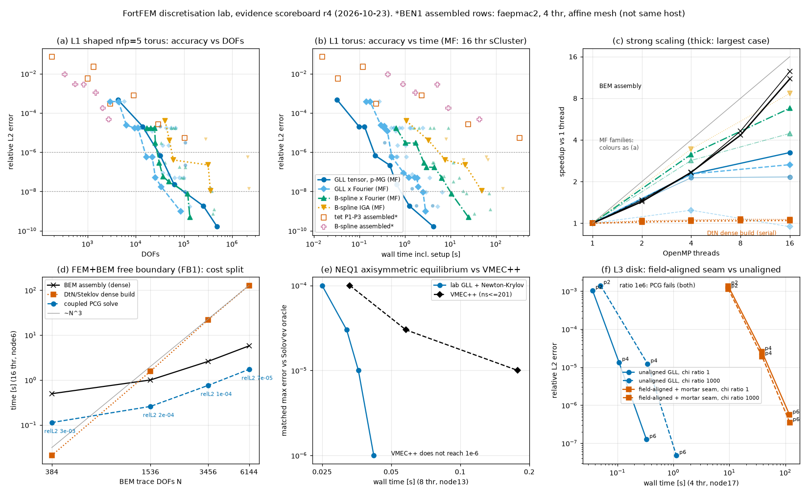

# Lab evidence scoreboard

Generated by `benchmark/lab/scoreboard.py` from existing measured rows only (no new runs). Do not edit by hand.

## Reading guide

- Error: L1/L3 relative L2 against the exact manufactured solution; L6 relative sampled B against the N1 exact oracle (a different quantity, never compare it with an L1/L3 number).
- Wall time is process wall time (assembly, setup, solve, error integral) for the lab CSVs. KIN6D rows are native phase-sum seconds on one core, a lower bound. VMEC++ rows are native solve seconds on one core.
- **Like-for-like groups.** Assembled tet/B-spline rows ran on faepmac2 with GCC 16.1 (revision 5a48864d), matrix-free GLL rows on faepmac1 with GCC 16.2, KIN6D/VMEC++/GVEC on sCluster node7 (GCC 12.2 / external builds). The round-4 matrix-free rows (IGA-AX, FB1, SEAM1, UNS1, NEQ1) are separate sCluster sweeps and are only comparable within their own job. Different hosts, compilers, geometries (affine-tetra vs curved torus) and solvers mean **every cross-family time ratio is [H], not [V]**. Only DOFs-vs-error within one family is a clean measurement.
- Criterion column: 1 FEM+BEM-ready interior, 2 axis regularity, 3 field-alignment optional, 4 time-to-solution vs VMEC-class codes.

## Headline, round-1 rows: best L1 wall time to reach a given error [H across families]

| target rel L2 | family | p | DOFs | rel L2 | wall s | threads | host | source |
|---|---|---:|---:|---:|---:|---:|---|---|
| <= 0.001 | GLL matrix-free (p-MG) | 4 | 7120 | 9.754e-04 | 0.074 | 4 | faepmac1 | benchmark/lab/mf-baselines-20261022.csv:4 |
| <= 0.001 | tet P1-P3 assembled | 3 | 2940 | 2.929e-04 | 0.236 | 4 | faepmac2 | benchmark/lab/baselines-20261022.csv:6 |
| <= 0.001 | tensor B-spline assembled | 3 | 2058 | 1.738e-04 | 9 | 4 | faepmac2 | benchmark/lab/baselines-20261022.csv:32 |
| <= 1e-05 | GLL matrix-free (p-MG) | 8 | 53920 | 1.198e-06 | 0.536 | 4 | faepmac1 | benchmark/lab/mf-extra-20261022.csv:3 |
| <= 1e-05 | tet P1-P3 assembled | 3 | 103860 | 5.389e-06 | 328 | 4 | faepmac2 | benchmark/lab/baselines-20261022.csv:28 |
| <= 1e-05 | tensor B-spline assembled | - | - | not reached | - | - | - | no row reaches this |
| <= 1e-07 | GLL matrix-free (p-MG) | 10 | 104200 | 3.608e-08 | 1.2 | 4 | faepmac1 | benchmark/lab/mf-high-20261022.csv:2 |
| <= 1e-07 | tet P1-P3 assembled | - | - | not reached | - | - | - | no row reaches this |
| <= 1e-07 | tensor B-spline assembled | - | - | not reached | - | - | - | no row reaches this |

The matrix-free GLL rows are the only family that reaches 1e-7 within the measured range; tet P3 and the B-spline rows were not run that far, so "not reached" means "not measured", not "cannot". Tet P3 reaches 5.4e-6 only at 103860 DOFs and 328 s.

## Figure

Top row x = DOFs, bottom row x = wall time, y = relative error, log-log. L3 panel: anisotropy ratio 1e6 only (filled: L3 curved/affine torus; hollow: L3a 2D square P1). L6 panel: reference VMEC++ (black diamonds) and KIN6D (Landreman integer case); there is no lab-layer solve of the N1 cases (NEQ1 solves axisymmetric Solov'ev only, see below).

## Round-4 evidence (2026-10-23): matrix-free families, FEM+BEM, aligned seam, islands, Newton-Krylov

### Matrix-free families on one exclusive node (L1 shaped nfp=5 torus, 16 threads)

IGA-AX job 3356269, sCluster node7, GCC 12.2, one source revision, all four families on the same host, compiler and geometry, so these times are a clean within-lab comparison. Wall time includes setup; best row reaching the target.

| target rel L2 | family | p | DOFs | rel L2 | wall s | source |
|---|---|---:|---:|---:|---:|---|
| <= 0.0001 | GLL matrix-free (p-MG) | 6 | 13896 | 2.028e-05 | 0.099 | benchmark/lab/data/igaax-scan-3356269.csv:14 |
| <= 0.0001 | GLL x Fourier matrix-free | 6 | 6369 | 2.389e-05 | 0.297 | benchmark/lab/data/igaax-scan-3356269.csv:15 |
| <= 0.0001 | B-spline x Fourier matrix-free | 3 | 17193 | 1.713e-05 | 0.648 | benchmark/lab/data/igaax-scan-3356269.csv:50 |
| <= 0.0001 | B-spline IGA matrix-free | 2 | 40704 | 3.893e-05 | 1.08 | benchmark/lab/data/igaax-scan-3356269.csv:42 |
| <= 1e-06 | GLL matrix-free (p-MG) | 8 | 32352 | 6.744e-07 | 0.224 | benchmark/lab/data/igaax-scan-3356269.csv:26 |
| <= 1e-06 | GLL x Fourier matrix-free | 8 | 16513 | 5.723e-07 | 0.518 | benchmark/lab/data/igaax-threads-3356269.csv:12 |
| <= 1e-06 | B-spline x Fourier matrix-free | 4 | 30772 | 2.919e-07 | 2.63 | benchmark/lab/data/igaax-scan-3356269.csv:58 |
| <= 1e-06 | B-spline IGA matrix-free | 4 | 60288 | 4.017e-07 | 7.75 | benchmark/lab/data/igaax-scan-3356269.csv:48 |
| <= 1e-08 | GLL matrix-free (p-MG) | 8 | 252096 | 1.842e-09 | 1.26 | benchmark/lab/data/igaax-scan-3356269.csv:30 |
| <= 1e-08 | GLL x Fourier matrix-free | 6 | 107705 | 9.061e-09 | 2.51 | benchmark/lab/data/igaax-threads-3356269.csv:22 |
| <= 1e-08 | B-spline x Fourier matrix-free | 4 | 119860 | 7.820e-09 | 10.6 | benchmark/lab/data/igaax-scan-3356269.csv:62 |
| <= 1e-08 | B-spline IGA matrix-free | - | - | not reached | - | no row reaches this |

- [V] Within these rows GLL tensor p-MG is the fastest to every target: at 1e-8 it needs 1.26 s against 2.51 s (GLL x Fourier) and 10.6 s (B-spline x Fourier); pure B-spline IGA does not reach 1e-8 (best 1.06e-8 is above the target, see the scan CSV: 354k DOFs, 49 s).
- [V] Thread scaling 1 to 16 (data/igaax-threads-3356269.csv): GLL 252k DOFs 3.2x, B-spline x Fourier 120k DOFs 6.8x, B-spline 60k DOFs 8.7x, GLL x Fourier 108k DOFs 2.7x. GLL leads in absolute time but scales worst; [H] its setup is nearly serial (IGA-AX handoff). The spline families scale better and still lose.
- [V] Criterion 2 (axis, 2D disk, data/igaax-disk-3356269.csv): the axis-region L2 error of the through-axis GLL and B-spline O-grids is at most 6.6e-8 on the coarsest meshes and falls to 4e-12 (GLL) and 1.3e-11 (B-spline) on the finest; the polar chart comparison does the same (at most 2.3e-7 down to 9e-14). Both families are axis-regular on the O-grid. [H] The causes of the spline cost (quadrature, non-p-robust MG) are discussed in IGA-AX, not measured here.

### FEM+BEM free boundary (FB1, job 3356163, node6, 16 threads)

- [V] Interior FEM + dense BEM/DtN transmission problem: relative L2 3.4e-3 to 6.9e-5 for 384 to 6144 trace DOFs. At 6144 trace DOFs the DtN dense build takes 127.5 s against 5.7 s BEM assembly and 1.7 s for the coupled PCG solve.
- [V] BEM assembly scales 1 to 16 threads 12.5 s to 1.0 s (n=2) and 28.6 s to 2.6 s (n=3); the DtN dense build does not scale (22.9 s to 21.9 s at n=3) and grows ~N^3. The dense DtN build, not the FEM solve, is the cost to remove.

### Field-aligned seam against unaligned (SEAM1 L3 disk, job 3356493, node17, 4 threads)

- [V] The field-aligned mesh with a mortar seam is 100 to 360 times slower than the unaligned GLL disk (p6, ratio 1: 119 s against 0.33 s) and gains at most a factor 1.4 in error (ratio 1e3, p = 2 and 6); at ratio 1 it is less accurate for every p (up to 4.4 times at p = 6). At ratio 1e6 PCG fails on both layouts. Alignment stays an optional accelerator (criterion 3), and this implementation is not one. [H] The cost of the mortar path, not the alignment itself, is the likely cause.

### Islands, 2D single helicity (UNS1, jobs 3356137_*, 16 threads, largest meshes: island L4 against O-grid L16 at 0.8 times the DOFs)

- [V] Up to chi = 1e5 the unaligned O-grid matches or beats the island mesh; at 1e9 the island mesh is 2.8 to 3.6 times more accurate (direct solve, p = 2/4/6). p-MG is not chi-robust: p = 4 and 6 do not converge in 500 iterations from chi = 1e7 on (rows marked not converged); the direct LDLT reference is slow. No fast stiff-anisotropy solver exists yet.

### Nonlinear equilibrium (NEQ1, axisymmetric Solov'ev, 8 threads, node13)

- [V on the handoff rows] Newton-Krylov with GLL p-MG reaches a matched max error of 1e-4/3e-5/1e-5 in 0.025/0.032/0.036 s against 0.033/0.058/0.178 s for VMEC++ (same node, native solve), and reaches 1e-6 and 1e-8 in 0.042 and 0.127 s where the VMEC++ scan (ns <= 201) does not. These are runs of 25 to 180 ms, so scheduling noise matters, and the error levels are matched-accuracy targets read from the handoff table, not individually measured errors. Axisymmetric only: no 3D equilibrium and no N1 L6 case has been solved on the lab layer.

Panels: (a, b) L1 accuracy against DOFs and time, thin markers all rows and lines the lower-left frontier per family, assembled BEN1 rows hollow (faepmac2, affine mesh, 4 threads: not the same host); (c) strong scaling; (d) FB1 cost split; (e) NEQ1 against VMEC++; (f) SEAM1 L3 disk.

## Missing evidence

| family / capability | status |
|---|---|
| Same-host, same-compiler, same-geometry timing of assembled tet/B-spline against the matrix-free families (assembled rows: faepmac2, affine mesh) | not measured; cross-family time ratios with the assembled rows are [H] |
| Assembled tet/B-spline beyond 1e-5 on L1 | not measured |
| p-robust smoother / weighted quadrature for B-spline MF (spline h-MG iterations grow 6/14/27/54 for p = 2..5) | not done (IGA-AX) |
| Chi-robust preconditioner for anisotropy >= 1e7 (p-MG not converged in 500 iterations) | no solver yet (UNS1) |
| Non-axisymmetric (3D) equilibrium Newton solve; lab-layer admission of the N1 L6 cases | no data yet; NEQ1 is axisymmetric Solov'ev only (lane NEQ1) |
| FEM+BEM beyond 6144 trace DOFs, parallel DtN build, fast BEM | not measured; dense DtN build is serial and ~N^3 (lane FB1) |
| 3D multi-helicity / stochastic island case | no data yet; UNS1 is 2D, single helicity |
| Field-aligned mesh at anisotropy 1e6 | PCG fails on both layouts (SEAM1 L3) |
| GVEC integer cases | incomplete (N1) |

## Full table

| problem | crit | family | p | DOFs | metric | error | wall s | thr | host | compiler | revision | source | note |
|---|---:|---|---:|---:|---|---:|---:|---:|---|---|---|---|---|
| FB1 | 1 | FEM + BEM free boundary (dense BEM/DtN) | 4 | 2136 | rel L2 vs transmission oracle | 3.379e-03 | 0.6275 | 16 | node6 | GCC 12.2 | 46fefb79 | benchmark/lab/data/fb1-sweep-3356163.csv:12 | job 3356163; trace 384; its 22; wall = t_bem 0.494 + t_dtn 0.0209 + t_solve 0.113 |
| FB1 | 1 | FEM + BEM free boundary (dense BEM/DtN) | 4 | 2136 | rel L2 vs transmission oracle | 3.379e-03 | 2.103 | 1 | node6 | GCC 12.2 | 46fefb79 | benchmark/lab/data/fb1-sweep-3356163.csv:16 | job 3356163; trace 384; its 22; wall = t_bem 2 + t_dtn 0.0224 + t_solve 0.0765 |
| FB1 | 1 | FEM + BEM free boundary (dense BEM/DtN) | 4 | 16176 | rel L2 vs transmission oracle | 2.454e-04 | 2.812 | 16 | node6 | GCC 12.2 | 46fefb79 | benchmark/lab/data/fb1-sweep-3356163.csv:6 | job 3356163; trace 1536; its 28; wall = t_bem 0.998 + t_dtn 1.56 + t_solve 0.257 |
| FB1 | 1 | FEM + BEM free boundary (dense BEM/DtN) | 4 | 16176 | rel L2 vs transmission oracle | 2.454e-04 | 14.93 | 1 | node6 | GCC 12.2 | 46fefb79 | benchmark/lab/data/fb1-sweep-3356163.csv:2 | job 3356163; trace 1536; its 28; wall = t_bem 12.5 + t_dtn 1.66 + t_solve 0.793 |
| FB1 | 1 | FEM + BEM free boundary (dense BEM/DtN) | 4 | 16176 | rel L2 vs transmission oracle | 2.454e-04 | 4.471 | 8 | node6 | GCC 12.2 | 46fefb79 | benchmark/lab/data/fb1-sweep-3356163.csv:5 | job 3356163; trace 1536; its 28; wall = t_bem 2.69 + t_dtn 1.55 + t_solve 0.224 |
| FB1 | 1 | FEM + BEM free boundary (dense BEM/DtN) | 4 | 16176 | rel L2 vs transmission oracle | 2.454e-04 | 7.244 | 4 | node6 | GCC 12.2 | 46fefb79 | benchmark/lab/data/fb1-sweep-3356163.csv:4 | job 3356163; trace 1536; its 28; wall = t_bem 5.36 + t_dtn 1.57 + t_solve 0.311 |
| FB1 | 1 | FEM + BEM free boundary (dense BEM/DtN) | 4 | 16176 | rel L2 vs transmission oracle | 2.454e-04 | 10.5 | 2 | node6 | GCC 12.2 | 46fefb79 | benchmark/lab/data/fb1-sweep-3356163.csv:3 | job 3356163; trace 1536; its 28; wall = t_bem 8.48 + t_dtn 1.59 + t_solve 0.436 |
| FB1 | 1 | FEM + BEM free boundary (dense BEM/DtN) | 4 | 53640 | rel L2 vs transmission oracle | 1.127e-04 | 35.47 | 4 | node6 | GCC 12.2 | 46fefb79 | benchmark/lab/data/fb1-sweep-3356163.csv:9 | job 3356163; trace 3456; its 31; wall = t_bem 12.2 + t_dtn 22.1 + t_solve 1.16 |
| FB1 | 1 | FEM + BEM free boundary (dense BEM/DtN) | 4 | 53640 | rel L2 vs transmission oracle | 1.127e-04 | 25.2 | 16 | node6 | GCC 12.2 | 46fefb79 | benchmark/lab/data/fb1-sweep-3356163.csv:11 | job 3356163; trace 3456; its 31; wall = t_bem 2.59 + t_dtn 21.9 + t_solve 0.755 |
| FB1 | 1 | FEM + BEM free boundary (dense BEM/DtN) | 4 | 53640 | rel L2 vs transmission oracle | 1.127e-04 | 44.25 | 2 | node6 | GCC 12.2 | 46fefb79 | benchmark/lab/data/fb1-sweep-3356163.csv:8 | job 3356163; trace 3456; its 31; wall = t_bem 20 + t_dtn 22.4 + t_solve 1.81 |
| FB1 | 1 | FEM + BEM free boundary (dense BEM/DtN) | 4 | 53640 | rel L2 vs transmission oracle | 1.127e-04 | 54.74 | 1 | node6 | GCC 12.2 | 46fefb79 | benchmark/lab/data/fb1-sweep-3356163.csv:7 | job 3356163; trace 3456; its 31; wall = t_bem 28.6 + t_dtn 22.9 + t_solve 3.25 |
| FB1 | 1 | FEM + BEM free boundary (dense BEM/DtN) | 4 | 53640 | rel L2 vs transmission oracle | 1.127e-04 | 29.44 | 8 | node6 | GCC 12.2 | 46fefb79 | benchmark/lab/data/fb1-sweep-3356163.csv:10 | job 3356163; trace 3456; its 31; wall = t_bem 6.61 + t_dtn 22 + t_solve 0.861 |
| FB1 | 1 | FEM + BEM free boundary (dense BEM/DtN) | 4 | 126048 | rel L2 vs transmission oracle | 6.879e-05 | 135 | 16 | node6 | GCC 12.2 | 46fefb79 | benchmark/lab/data/fb1-sweep-3356163.csv:15 | job 3356163; trace 6144; its 33; wall = t_bem 5.74 + t_dtn 128 + t_solve 1.72 |
| L1 | 1 | GLL matrix-free (p-MG) | 2 | 1000 | rel L2 vs exact | 2.550e-02 | 0.04606 | 4 | faepmac1 | GCC 16.2.0 | 6f6c43d4 | benchmark/lab/mf-baselines-20261022.csv:2 |  |
| L1 | 1 | GLL matrix-free (p-MG) | 3 | 3120 | rel L2 vs exact | 2.712e-03 | 0.0478 | 4 | faepmac1 | GCC 16.2.0 | 6f6c43d4 | benchmark/lab/mf-baselines-20261022.csv:3 |  |
| L1 | 1 | GLL matrix-free (p-MG) | 4 | 4272 | rel L2 vs exact | 4.611e-04 | 0.0327 | 16 | node7 | GCC 12.2 | 3bf52b95 | benchmark/lab/data/igaax-scan-3356269.csv:2 | job 3356269; 9 PCG its |
| L1 | 1 | GLL matrix-free (p-MG) | 4 | 7120 | rel L2 vs exact | 9.754e-04 | 0.07397 | 4 | faepmac1 | GCC 16.2.0 | 6f6c43d4 | benchmark/lab/mf-baselines-20261022.csv:4 |  |
| L1 | 1 | GLL matrix-free (p-MG) | 6 | 13896 | rel L2 vs exact | 2.028e-05 | 0.099 | 16 | node7 | GCC 12.2 | 3bf52b95 | benchmark/lab/data/igaax-scan-3356269.csv:14 | job 3356269; 12 PCG its |
| L1 | 1 | GLL matrix-free (p-MG) | 6 | 23160 | rel L2 vs exact | 3.678e-05 | 0.2285 | 4 | faepmac1 | GCC 16.2.0 | 4f0bd43b | benchmark/lab/mf-extra-20261022.csv:2 |  |
| L1 | 1 | GLL matrix-free (p-MG) | 4 | 32352 | rel L2 vs exact | 1.991e-05 | 0.1307 | 16 | node7 | GCC 12.2 | 3bf52b95 | benchmark/lab/data/igaax-scan-3356269.csv:6 | job 3356269; 11 PCG its |
| L1 | 1 | GLL matrix-free (p-MG) | 8 | 32352 | rel L2 vs exact | 6.744e-07 | 0.2238 | 16 | node7 | GCC 12.2 | 3bf52b95 | benchmark/lab/data/igaax-scan-3356269.csv:26 | job 3356269; 14 PCG its |
| L1 | 1 | GLL matrix-free (p-MG) | 8 | 32352 | rel L2 vs exact | 6.744e-07 | 0.4885 | 1 | node7 | GCC 12.2 | 3bf52b95 | benchmark/lab/data/igaax-threads-3356269.csv:2 | job 3356269; 14 PCG its |
| L1 | 1 | GLL matrix-free (p-MG) | 8 | 32352 | rel L2 vs exact | 6.744e-07 | 0.2292 | 4 | node7 | GCC 12.2 | 3bf52b95 | benchmark/lab/data/igaax-threads-3356269.csv:3 | job 3356269; 14 PCG its |
| L1 | 1 | GLL matrix-free (p-MG) | 8 | 32352 | rel L2 vs exact | 6.744e-07 | 0.2259 | 16 | node7 | GCC 12.2 | 3bf52b95 | benchmark/lab/data/igaax-threads-3356269.csv:4 | job 3356269; 14 PCG its |
| L1 | 1 | GLL matrix-free (p-MG) | 4 | 53920 | rel L2 vs exact | 2.116e-05 | 0.4396 | 4 | faepmac1 | GCC 16.2.0 | 6f6c43d4 | benchmark/lab/mf-baselines-20261022.csv:5 |  |
| L1 | 1 | GLL matrix-free (p-MG) | 8 | 53920 | rel L2 vs exact | 1.198e-06 | 0.5361 | 4 | faepmac1 | GCC 16.2.0 | 4f0bd43b | benchmark/lab/mf-extra-20261022.csv:3 |  |
| L1 | 1 | GLL matrix-free (p-MG) | 10 | 62520 | rel L2 vs exact | 2.248e-08 | 0.658 | 16 | node7 | GCC 12.2 | 3bf52b95 | benchmark/lab/data/igaax-scan-3356269.csv:34 | job 3356269; 16 PCG its |
| L1 | 1 | GLL matrix-free (p-MG) | 10 | 104200 | rel L2 vs exact | 3.608e-08 | 1.203 | 4 | faepmac1 | GCC 16.2.0 | 4a901e5f | benchmark/lab/mf-high-20261022.csv:2 |  |
| L1 | 1 | GLL matrix-free (p-MG) | 4 | 107280 | rel L2 vs exact | 3.006e-06 | 0.3631 | 16 | node7 | GCC 12.2 | 3bf52b95 | benchmark/lab/data/igaax-scan-3356269.csv:10 | job 3356269; 11 PCG its |
| L1 | 1 | GLL matrix-free (p-MG) | 6 | 107280 | rel L2 vs exact | 2.136e-07 | 0.4701 | 16 | node7 | GCC 12.2 | 3bf52b95 | benchmark/lab/data/igaax-scan-3356269.csv:18 | job 3356269; 13 PCG its |
| L1 | 1 | GLL matrix-free (p-MG) | - | 117649 | (solve only; no error recorded) | - | 2.051 | 16 | sCluster node4 | GCC (MF1 sweep) | 25ec09e2 | fortfem_lab/MF1_HANDOFF.md:27 | MF1 scaling sweep 3355311, 7 PCG its, 3.536 s at 1 thread; table only |
| L1 | 1 | GLL matrix-free (p-MG) | 4 | 178800 | rel L2 vs exact | 3.613e-06 | 1.973 | 4 | faepmac1 | GCC 16.2.0 | 4f0bd43b | benchmark/lab/mf-extra-20261022.csv:4 |  |
| L1 | 1 | GLL matrix-free (p-MG) | 8 | 252096 | rel L2 vs exact | 1.842e-09 | 1.258 | 16 | node7 | GCC 12.2 | 3bf52b95 | benchmark/lab/data/igaax-scan-3356269.csv:30 | job 3356269; 15 PCG its |
| L1 | 1 | GLL matrix-free (p-MG) | 8 | 252096 | rel L2 vs exact | 1.842e-09 | 4.1 | 1 | node7 | GCC 12.2 | 3bf52b95 | benchmark/lab/data/igaax-threads-3356269.csv:14 | job 3356269; 15 PCG its |
| L1 | 1 | GLL matrix-free (p-MG) | 8 | 252096 | rel L2 vs exact | 1.842e-09 | 1.81 | 4 | node7 | GCC 12.2 | 3bf52b95 | benchmark/lab/data/igaax-threads-3356269.csv:15 | job 3356269; 15 PCG its |
| L1 | 1 | GLL matrix-free (p-MG) | 8 | 252096 | rel L2 vs exact | 1.842e-09 | 1.264 | 16 | node7 | GCC 12.2 | 3bf52b95 | benchmark/lab/data/igaax-threads-3356269.csv:16 | job 3356269; 15 PCG its |
| L1 | 1 | GLL matrix-free (p-MG) | 6 | 357912 | rel L2 vs exact | 1.364e-08 | 1.454 | 16 | node7 | GCC 12.2 | 3bf52b95 | benchmark/lab/data/igaax-scan-3356269.csv:22 | job 3356269; 13 PCG its |
| L1 | 1 | GLL matrix-free (p-MG) | 10 | 489840 | rel L2 vs exact | 1.595e-10 | 4.255 | 16 | node7 | GCC 12.2 | 3bf52b95 | benchmark/lab/data/igaax-scan-3356269.csv:38 | job 3356269; 16 PCG its |
| L1 | 1 | tet P1-P3 assembled | 1 | 180 | rel L2 vs exact | 7.290e-02 | 0.01531 | 4 | faepmac2 | GCC 16.1.0 | 5a48864d | benchmark/lab/baselines-20261022.csv:2 |  |
| L1 | 1 | tet P1-P3 assembled | 2 | 1000 | rel L2 vs exact | 5.629e-03 | 0.03395 | 4 | faepmac2 | GCC 16.1.0 | 5a48864d | benchmark/lab/baselines-20261022.csv:4 |  |
| L1 | 1 | tet P1-P3 assembled | 1 | 1320 | rel L2 vs exact | 2.243e-02 | 0.1201 | 4 | faepmac2 | GCC 16.1.0 | 5a48864d | benchmark/lab/baselines-20261022.csv:3 |  |
| L1 | 1 | tet P1-P3 assembled | 3 | 2940 | rel L2 vs exact | 2.929e-04 | 0.2362 | 4 | faepmac2 | GCC 16.1.0 | 5a48864d | benchmark/lab/baselines-20261022.csv:6 |  |
| L1 | 1 | tet P1-P3 assembled | 2 | 9040 | rel L2 vs exact | 7.697e-04 | 2.334 | 4 | faepmac2 | GCC 16.1.0 | 5a48864d | benchmark/lab/baselines-20261022.csv:5 |  |
| L1 | 1 | tet P1-P3 assembled | 3 | 28920 | rel L2 vs exact | 2.615e-05 | 24.56 | 4 | faepmac2 | GCC 16.1.0 | 5a48864d | benchmark/lab/baselines-20261022.csv:7 |  |
| L1 | 1 | tet P1-P3 assembled | 3 | 103860 | rel L2 vs exact | 5.389e-06 | 328.2 | 4 | faepmac2 | GCC 16.1.0 | 5a48864d | benchmark/lab/baselines-20261022.csv:28 |  |
| L1 | 1 | tensor B-spline assembled | 2 | 336 | rel L2 vs exact | 9.167e-03 | 0.4261 | 4 | faepmac2 | GCC 16.1.0 | 5a48864d | benchmark/lab/baselines-20261022.csv:29 |  |
| L1 | 1 | tensor B-spline assembled | 3 | 550 | rel L2 vs exact | 2.872e-03 | 0.9158 | 4 | faepmac2 | GCC 16.1.0 | 5a48864d | benchmark/lab/baselines-20261022.csv:31 |  |
| L1 | 1 | tensor B-spline assembled | 4 | 828 | rel L2 vs exact | 2.812e-03 | 5.183 | 4 | faepmac2 | GCC 16.1.0 | 5a48864d | benchmark/lab/baselines-20261022.csv:33 |  |
| L1 | 1 | tensor B-spline assembled | 2 | 1476 | rel L2 vs exact | 1.078e-03 | 1.708 | 4 | faepmac2 | GCC 16.1.0 | 5a48864d | benchmark/lab/baselines-20261022.csv:30 |  |
| L1 | 1 | tensor B-spline assembled | 3 | 2058 | rel L2 vs exact | 1.738e-04 | 8.996 | 4 | faepmac2 | GCC 16.1.0 | 5a48864d | benchmark/lab/baselines-20261022.csv:32 |  |
| L1 | 1 | tensor B-spline assembled | 4 | 2752 | rel L2 vs exact | 4.674e-05 | 43.31 | 4 | faepmac2 | GCC 16.1.0 | 5a48864d | benchmark/lab/baselines-20261022.csv:34 |  |
| L1 | 1 | GLL x Fourier matrix-free | 4 | 2937 | rel L2 vs exact | 3.795e-04 | 0.142 | 16 | node7 | GCC 12.2 | 3bf52b95 | benchmark/lab/data/igaax-scan-3356269.csv:3 | job 3356269; 11 PCG its |
| L1 | 1 | GLL x Fourier matrix-free | 4 | 4361 | rel L2 vs exact | 3.791e-04 | 0.1729 | 16 | node7 | GCC 12.2 | 3bf52b95 | benchmark/lab/data/igaax-scan-3356269.csv:4 | job 3356269; 9 PCG its |
| L1 | 1 | GLL x Fourier matrix-free | 4 | 5785 | rel L2 vs exact | 3.791e-04 | 0.2776 | 16 | node7 | GCC 12.2 | 3bf52b95 | benchmark/lab/data/igaax-scan-3356269.csv:5 | job 3356269; 7 PCG its |
| L1 | 1 | GLL x Fourier matrix-free | 6 | 6369 | rel L2 vs exact | 2.389e-05 | 0.2968 | 16 | node7 | GCC 12.2 | 3bf52b95 | benchmark/lab/data/igaax-scan-3356269.csv:15 | job 3356269; 19 PCG its |
| L1 | 1 | GLL x Fourier matrix-free | 6 | 9457 | rel L2 vs exact | 1.691e-05 | 0.361 | 16 | node7 | GCC 12.2 | 3bf52b95 | benchmark/lab/data/igaax-scan-3356269.csv:16 | job 3356269; 14 PCG its |
| L1 | 1 | GLL x Fourier matrix-free | 4 | 11121 | rel L2 vs exact | 2.055e-05 | 0.3544 | 16 | node7 | GCC 12.2 | 3bf52b95 | benchmark/lab/data/igaax-scan-3356269.csv:7 | job 3356269; 23 PCG its |
| L1 | 1 | GLL x Fourier matrix-free | 8 | 11121 | rel L2 vs exact | 1.689e-05 | 0.5081 | 16 | node7 | GCC 12.2 | 3bf52b95 | benchmark/lab/data/igaax-scan-3356269.csv:27 | job 3356269; 27 PCG its |
| L1 | 1 | GLL x Fourier matrix-free | 6 | 12545 | rel L2 vs exact | 1.691e-05 | 0.585 | 16 | node7 | GCC 12.2 | 3bf52b95 | benchmark/lab/data/igaax-scan-3356269.csv:17 | job 3356269; 11 PCG its |
| L1 | 1 | GLL x Fourier matrix-free | 4 | 16513 | rel L2 vs exact | 1.172e-05 | 0.415 | 16 | node7 | GCC 12.2 | 3bf52b95 | benchmark/lab/data/igaax-scan-3356269.csv:8 | job 3356269; 17 PCG its |
| L1 | 1 | GLL x Fourier matrix-free | 8 | 16513 | rel L2 vs exact | 5.723e-07 | 0.6782 | 16 | node7 | GCC 12.2 | 3bf52b95 | benchmark/lab/data/igaax-scan-3356269.csv:28 | job 3356269; 20 PCG its |
| L1 | 1 | GLL x Fourier matrix-free | 8 | 16513 | rel L2 vs exact | 5.723e-07 | 0.643 | 1 | node7 | GCC 12.2 | 3bf52b95 | benchmark/lab/data/igaax-threads-3356269.csv:11 | job 3356269; 20 PCG its |
| L1 | 1 | GLL x Fourier matrix-free | 8 | 16513 | rel L2 vs exact | 5.723e-07 | 0.5178 | 4 | node7 | GCC 12.2 | 3bf52b95 | benchmark/lab/data/igaax-threads-3356269.csv:12 | job 3356269; 20 PCG its |
| L1 | 1 | GLL x Fourier matrix-free | 8 | 16513 | rel L2 vs exact | 5.723e-07 | 0.6814 | 16 | node7 | GCC 12.2 | 3bf52b95 | benchmark/lab/data/igaax-threads-3356269.csv:13 | job 3356269; 20 PCG its |
| L1 | 1 | GLL x Fourier matrix-free | 10 | 17193 | rel L2 vs exact | 1.688e-05 | 0.8783 | 16 | node7 | GCC 12.2 | 3bf52b95 | benchmark/lab/data/igaax-scan-3356269.csv:35 | job 3356269; 35 PCG its |
| L1 | 1 | GLL x Fourier matrix-free | 4 | 21905 | rel L2 vs exact | 1.172e-05 | 0.6386 | 16 | node7 | GCC 12.2 | 3bf52b95 | benchmark/lab/data/igaax-scan-3356269.csv:9 | job 3356269; 13 PCG its |
| L1 | 1 | GLL x Fourier matrix-free | 8 | 21905 | rel L2 vs exact | 5.702e-07 | 1.087 | 16 | node7 | GCC 12.2 | 3bf52b95 | benchmark/lab/data/igaax-scan-3356269.csv:29 | job 3356269; 15 PCG its |
| L1 | 1 | GLL x Fourier matrix-free | 4 | 24585 | rel L2 vs exact | 1.702e-05 | 0.5801 | 16 | node7 | GCC 12.2 | 3bf52b95 | benchmark/lab/data/igaax-scan-3356269.csv:11 | job 3356269; 34 PCG its |
| L1 | 1 | GLL x Fourier matrix-free | 6 | 24585 | rel L2 vs exact | 1.688e-05 | 0.7713 | 16 | node7 | GCC 12.2 | 3bf52b95 | benchmark/lab/data/igaax-scan-3356269.csv:19 | job 3356269; 38 PCG its |
| L1 | 1 | GLL x Fourier matrix-free | 10 | 25529 | rel L2 vs exact | 5.169e-08 | 1.232 | 16 | node7 | GCC 12.2 | 3bf52b95 | benchmark/lab/data/igaax-scan-3356269.csv:36 | job 3356269; 26 PCG its |
| L1 | 1 | GLL x Fourier matrix-free | 10 | 33865 | rel L2 vs exact | 1.727e-08 | 1.954 | 16 | node7 | GCC 12.2 | 3bf52b95 | benchmark/lab/data/igaax-scan-3356269.csv:37 | job 3356269; 20 PCG its |
| L1 | 1 | GLL x Fourier matrix-free | 4 | 36505 | rel L2 vs exact | 2.182e-06 | 0.6969 | 16 | node7 | GCC 12.2 | 3bf52b95 | benchmark/lab/data/igaax-scan-3356269.csv:12 | job 3356269; 25 PCG its |
| L1 | 1 | GLL x Fourier matrix-free | 6 | 36505 | rel L2 vs exact | 8.748e-08 | 0.9452 | 16 | node7 | GCC 12.2 | 3bf52b95 | benchmark/lab/data/igaax-scan-3356269.csv:20 | job 3356269; 27 PCG its |
| L1 | 1 | GLL x Fourier matrix-free | 8 | 43329 | rel L2 vs exact | 1.688e-05 | 1.378 | 16 | node7 | GCC 12.2 | 3bf52b95 | benchmark/lab/data/igaax-scan-3356269.csv:31 | job 3356269; 53 PCG its |
| L1 | 1 | GLL x Fourier matrix-free | 4 | 48425 | rel L2 vs exact | 2.181e-06 | 1.051 | 16 | node7 | GCC 12.2 | 3bf52b95 | benchmark/lab/data/igaax-scan-3356269.csv:13 | job 3356269; 19 PCG its |
| L1 | 1 | GLL x Fourier matrix-free | 6 | 48425 | rel L2 vs exact | 7.266e-08 | 1.463 | 16 | node7 | GCC 12.2 | 3bf52b95 | benchmark/lab/data/igaax-scan-3356269.csv:21 | job 3356269; 21 PCG its |
| L1 | 1 | GLL x Fourier matrix-free | 6 | 54681 | rel L2 vs exact | 1.688e-05 | 1.295 | 16 | node7 | GCC 12.2 | 3bf52b95 | benchmark/lab/data/igaax-scan-3356269.csv:23 | job 3356269; 55 PCG its |
| L1 | 1 | GLL x Fourier matrix-free | 8 | 64337 | rel L2 vs exact | 4.872e-08 | 1.851 | 16 | node7 | GCC 12.2 | 3bf52b95 | benchmark/lab/data/igaax-scan-3356269.csv:32 | job 3356269; 38 PCG its |
| L1 | 1 | GLL x Fourier matrix-free | 10 | 67353 | rel L2 vs exact | 1.688e-05 | 2.499 | 16 | node7 | GCC 12.2 | 3bf52b95 | benchmark/lab/data/igaax-scan-3356269.csv:39 | job 3356269; 69 PCG its |
| L1 | 1 | GLL x Fourier matrix-free | 6 | 81193 | rel L2 vs exact | 4.955e-08 | 1.644 | 16 | node7 | GCC 12.2 | 3bf52b95 | benchmark/lab/data/igaax-scan-3356269.csv:24 | job 3356269; 40 PCG its |
| L1 | 1 | GLL x Fourier matrix-free | 8 | 85345 | rel L2 vs exact | 9.690e-10 | 2.86 | 16 | node7 | GCC 12.2 | 3bf52b95 | benchmark/lab/data/igaax-scan-3356269.csv:33 | job 3356269; 29 PCG its |
| L1 | 1 | GLL x Fourier matrix-free | 10 | 100009 | rel L2 vs exact | 4.875e-08 | 3.539 | 16 | node7 | GCC 12.2 | 3bf52b95 | benchmark/lab/data/igaax-scan-3356269.csv:40 | job 3356269; 49 PCG its |
| L1 | 1 | GLL x Fourier matrix-free | 6 | 107705 | rel L2 vs exact | 9.061e-09 | 2.515 | 16 | node7 | GCC 12.2 | 3bf52b95 | benchmark/lab/data/igaax-scan-3356269.csv:25 | job 3356269; 31 PCG its |
| L1 | 1 | GLL x Fourier matrix-free | 6 | 107705 | rel L2 vs exact | 9.061e-09 | 6.665 | 1 | node7 | GCC 12.2 | 3bf52b95 | benchmark/lab/data/igaax-threads-3356269.csv:20 | job 3356269; 31 PCG its |
| L1 | 1 | GLL x Fourier matrix-free | 6 | 107705 | rel L2 vs exact | 9.061e-09 | 2.935 | 4 | node7 | GCC 12.2 | 3bf52b95 | benchmark/lab/data/igaax-threads-3356269.csv:21 | job 3356269; 31 PCG its |
| L1 | 1 | GLL x Fourier matrix-free | 6 | 107705 | rel L2 vs exact | 9.061e-09 | 2.514 | 16 | node7 | GCC 12.2 | 3bf52b95 | benchmark/lab/data/igaax-threads-3356269.csv:22 | job 3356269; 31 PCG its |
| L1 | 1 | GLL x Fourier matrix-free | 10 | 132665 | rel L2 vs exact | 1.681e-09 | 5.289 | 16 | node7 | GCC 12.2 | 3bf52b95 | benchmark/lab/data/igaax-scan-3356269.csv:41 | job 3356269; 37 PCG its |
| L1 | 1 | B-spline x Fourier matrix-free | 3 | 17193 | rel L2 vs exact | 1.713e-05 | 0.6479 | 16 | node7 | GCC 12.2 | 3bf52b95 | benchmark/lab/data/igaax-scan-3356269.csv:50 | job 3356269; 16 PCG its |
| L1 | 1 | B-spline x Fourier matrix-free | 4 | 20724 | rel L2 vs exact | 1.688e-05 | 1.594 | 16 | node7 | GCC 12.2 | 3bf52b95 | benchmark/lab/data/igaax-scan-3356269.csv:57 | job 3356269; 32 PCG its |
| L1 | 1 | B-spline x Fourier matrix-free | 5 | 24585 | rel L2 vs exact | 1.688e-05 | 4.382 | 16 | node7 | GCC 12.2 | 3bf52b95 | benchmark/lab/data/igaax-scan-3356269.csv:64 | job 3356269; 67 PCG its |
| L1 | 1 | B-spline x Fourier matrix-free | 3 | 25529 | rel L2 vs exact | 2.917e-06 | 1.026 | 16 | node7 | GCC 12.2 | 3bf52b95 | benchmark/lab/data/igaax-scan-3356269.csv:51 | job 3356269; 15 PCG its |
| L1 | 1 | B-spline x Fourier matrix-free | 4 | 30772 | rel L2 vs exact | 2.919e-07 | 2.626 | 16 | node7 | GCC 12.2 | 3bf52b95 | benchmark/lab/data/igaax-scan-3356269.csv:58 | job 3356269; 31 PCG its |
| L1 | 1 | B-spline x Fourier matrix-free | 4 | 30772 | rel L2 vs exact | 2.919e-07 | 11.74 | 1 | node7 | GCC 12.2 | 3bf52b95 | benchmark/lab/data/igaax-threads-3356269.csv:8 | job 3356269; 31 PCG its |
| L1 | 1 | B-spline x Fourier matrix-free | 4 | 30772 | rel L2 vs exact | 2.919e-07 | 4.127 | 4 | node7 | GCC 12.2 | 3bf52b95 | benchmark/lab/data/igaax-threads-3356269.csv:9 | job 3356269; 31 PCG its |
| L1 | 1 | B-spline x Fourier matrix-free | 4 | 30772 | rel L2 vs exact | 2.919e-07 | 2.635 | 16 | node7 | GCC 12.2 | 3bf52b95 | benchmark/lab/data/igaax-threads-3356269.csv:10 | job 3356269; 31 PCG its |
| L1 | 1 | B-spline x Fourier matrix-free | 3 | 33865 | rel L2 vs exact | 2.917e-06 | 1.741 | 16 | node7 | GCC 12.2 | 3bf52b95 | benchmark/lab/data/igaax-scan-3356269.csv:52 | job 3356269; 15 PCG its |
| L1 | 1 | B-spline x Fourier matrix-free | 5 | 36505 | rel L2 vs exact | 5.795e-08 | 7.3 | 16 | node7 | GCC 12.2 | 3bf52b95 | benchmark/lab/data/igaax-scan-3356269.csv:65 | job 3356269; 66 PCG its |
| L1 | 1 | B-spline x Fourier matrix-free | 4 | 40820 | rel L2 vs exact | 2.878e-07 | 4.357 | 16 | node7 | GCC 12.2 | 3bf52b95 | benchmark/lab/data/igaax-scan-3356269.csv:59 | job 3356269; 31 PCG its |
| L1 | 1 | B-spline x Fourier matrix-free | 5 | 48425 | rel L2 vs exact | 3.138e-08 | 11.73 | 16 | node7 | GCC 12.2 | 3bf52b95 | benchmark/lab/data/igaax-scan-3356269.csv:66 | job 3356269; 66 PCG its |
| L1 | 1 | B-spline x Fourier matrix-free | 3 | 54681 | rel L2 vs exact | 1.688e-05 | 2.068 | 16 | node7 | GCC 12.2 | 3bf52b95 | benchmark/lab/data/igaax-scan-3356269.csv:53 | job 3356269; 26 PCG its |
| L1 | 1 | B-spline x Fourier matrix-free | 4 | 60852 | rel L2 vs exact | 1.688e-05 | 3.63 | 16 | node7 | GCC 12.2 | 3bf52b95 | benchmark/lab/data/igaax-scan-3356269.csv:60 | job 3356269; 31 PCG its |
| L1 | 1 | B-spline x Fourier matrix-free | 5 | 67353 | rel L2 vs exact | 1.688e-05 | 9.118 | 16 | node7 | GCC 12.2 | 3bf52b95 | benchmark/lab/data/igaax-scan-3356269.csv:67 | job 3356269; 59 PCG its |
| L1 | 1 | B-spline x Fourier matrix-free | 3 | 81193 | rel L2 vs exact | 1.743e-07 | 2.98 | 16 | node7 | GCC 12.2 | 3bf52b95 | benchmark/lab/data/igaax-scan-3356269.csv:54 | job 3356269; 19 PCG its |
| L1 | 1 | B-spline x Fourier matrix-free | 4 | 90356 | rel L2 vs exact | 4.934e-08 | 6.519 | 16 | node7 | GCC 12.2 | 3bf52b95 | benchmark/lab/data/igaax-scan-3356269.csv:61 | job 3356269; 30 PCG its |
| L1 | 1 | B-spline x Fourier matrix-free | 5 | 100009 | rel L2 vs exact | 4.872e-08 | 15.82 | 16 | node7 | GCC 12.2 | 3bf52b95 | benchmark/lab/data/igaax-scan-3356269.csv:68 | job 3356269; 59 PCG its |
| L1 | 1 | B-spline x Fourier matrix-free | 3 | 107705 | rel L2 vs exact | 1.674e-07 | 4.476 | 16 | node7 | GCC 12.2 | 3bf52b95 | benchmark/lab/data/igaax-scan-3356269.csv:55 | job 3356269; 16 PCG its |
| L1 | 1 | B-spline x Fourier matrix-free | 4 | 119860 | rel L2 vs exact | 7.820e-09 | 10.56 | 16 | node7 | GCC 12.2 | 3bf52b95 | benchmark/lab/data/igaax-scan-3356269.csv:62 | job 3356269; 30 PCG its |
| L1 | 1 | B-spline x Fourier matrix-free | 4 | 119860 | rel L2 vs exact | 7.820e-09 | 71.78 | 1 | node7 | GCC 12.2 | 3bf52b95 | benchmark/lab/data/igaax-threads-3356269.csv:17 | job 3356269; 30 PCG its |
| L1 | 1 | B-spline x Fourier matrix-free | 4 | 119860 | rel L2 vs exact | 7.820e-09 | 22.81 | 4 | node7 | GCC 12.2 | 3bf52b95 | benchmark/lab/data/igaax-threads-3356269.csv:18 | job 3356269; 30 PCG its |
| L1 | 1 | B-spline x Fourier matrix-free | 4 | 119860 | rel L2 vs exact | 7.820e-09 | 10.58 | 16 | node7 | GCC 12.2 | 3bf52b95 | benchmark/lab/data/igaax-threads-3356269.csv:19 | job 3356269; 30 PCG its |
| L1 | 1 | B-spline x Fourier matrix-free | 5 | 132665 | rel L2 vs exact | 4.779e-10 | 25.02 | 16 | node7 | GCC 12.2 | 3bf52b95 | benchmark/lab/data/igaax-scan-3356269.csv:69 | job 3356269; 59 PCG its |
| L1 | 1 | B-spline x Fourier matrix-free | 3 | 380185 | rel L2 vs exact | 1.031e-08 | 19.28 | 16 | node7 | GCC 12.2 | 3bf52b95 | benchmark/lab/data/igaax-scan-3356269.csv:56 | job 3356269; 26 PCG its |
| L1 | 1 | B-spline x Fourier matrix-free | 4 | 402740 | rel L2 vs exact | 7.194e-10 | 33.92 | 16 | node7 | GCC 12.2 | 3bf52b95 | benchmark/lab/data/igaax-scan-3356269.csv:63 | job 3356269; 30 PCG its |
| L1 | 1 | B-spline x Fourier matrix-free | 5 | 425945 | rel L2 vs exact | 1.198e-09 | 75.89 | 16 | node7 | GCC 12.2 | 3bf52b95 | benchmark/lab/data/igaax-scan-3356269.csv:70 | job 3356269; 56 PCG its |
| L1 | 1 | B-spline IGA matrix-free | 2 | 40704 | rel L2 vs exact | 3.893e-05 | 1.082 | 16 | node7 | GCC 12.2 | 3bf52b95 | benchmark/lab/data/igaax-scan-3356269.csv:42 | job 3356269; 14 PCG its |
| L1 | 1 | B-spline IGA matrix-free | 3 | 50016 | rel L2 vs exact | 3.933e-06 | 3.337 | 16 | node7 | GCC 12.2 | 3bf52b95 | benchmark/lab/data/igaax-scan-3356269.csv:45 | job 3356269; 32 PCG its |
| L1 | 1 | B-spline IGA matrix-free | 4 | 60288 | rel L2 vs exact | 4.017e-07 | 7.748 | 16 | node7 | GCC 12.2 | 3bf52b95 | benchmark/lab/data/igaax-scan-3356269.csv:48 | job 3356269; 40 PCG its |
| L1 | 1 | B-spline IGA matrix-free | 4 | 60288 | rel L2 vs exact | 4.017e-07 | 67.23 | 1 | node7 | GCC 12.2 | 3bf52b95 | benchmark/lab/data/igaax-threads-3356269.csv:5 | job 3356269; 40 PCG its |
| L1 | 1 | B-spline IGA matrix-free | 4 | 60288 | rel L2 vs exact | 4.017e-07 | 19.54 | 4 | node7 | GCC 12.2 | 3bf52b95 | benchmark/lab/data/igaax-threads-3356269.csv:6 | job 3356269; 40 PCG its |
| L1 | 1 | B-spline IGA matrix-free | 4 | 60288 | rel L2 vs exact | 4.017e-07 | 7.751 | 16 | node7 | GCC 12.2 | 3bf52b95 | benchmark/lab/data/igaax-threads-3356269.csv:7 | job 3356269; 40 PCG its |
| L1 | 1 | B-spline IGA matrix-free | 2 | 284160 | rel L2 vs exact | 4.540e-06 | 8.121 | 16 | node7 | GCC 12.2 | 3bf52b95 | benchmark/lab/data/igaax-scan-3356269.csv:43 | job 3356269; 13 PCG its |
| L1 | 1 | B-spline IGA matrix-free | 3 | 318144 | rel L2 vs exact | 2.230e-07 | 21.24 | 16 | node7 | GCC 12.2 | 3bf52b95 | benchmark/lab/data/igaax-scan-3356269.csv:46 | job 3356269; 24 PCG its |
| L1 | 1 | B-spline IGA matrix-free | 4 | 354048 | rel L2 vs exact | 1.063e-08 | 49.05 | 16 | node7 | GCC 12.2 | 3bf52b95 | benchmark/lab/data/igaax-scan-3356269.csv:49 | job 3356269; 32 PCG its |
| L1 | 1 | B-spline IGA matrix-free | 2 | 2116608 | rel L2 vs exact | 5.573e-07 | 61.98 | 16 | node7 | GCC 12.2 | 3bf52b95 | benchmark/lab/data/igaax-scan-3356269.csv:44 | job 3356269; 12 PCG its |
| L1 | 1 | B-spline IGA matrix-free | 3 | 2246016 | rel L2 vs exact | 1.362e-08 | 142.9 | 16 | node7 | GCC 12.2 | 3bf52b95 | benchmark/lab/data/igaax-scan-3356269.csv:47 | job 3356269; 17 PCG its |
| L2 | 1 | tet P1-P3 assembled | 1 | 820 | rel L2 vs exact | 3.130e-01 | 0.3297 | 4 | faepmac2 | GCC 16.1.0 | 5a48864d | benchmark/lab/additional-20261022.csv:2 | err>=0.3, not resolved |
| L3 | 3 | GLL matrix-free (p-MG) | 2 | - | rel L2 vs exact | - | - | 4 | node17 | GCC 12.2 | 817dad00 | benchmark/lab/data/seam1-l3-3356493.csv:6 | job 3356493; disk; chi ratio 1e+06; failed: exit 1 |
| L3 | 3 | GLL matrix-free (p-MG) | 4 | - | rel L2 vs exact | - | - | 4 | node17 | GCC 12.2 | 817dad00 | benchmark/lab/data/seam1-l3-3356493.csv:12 | job 3356493; disk; chi ratio 1e+06; failed: exit 1 |
| L3 | 3 | GLL matrix-free (p-MG) | 6 | - | rel L2 vs exact | - | - | 4 | node17 | GCC 12.2 | 817dad00 | benchmark/lab/data/seam1-l3-3356493.csv:18 | job 3356493; disk; chi ratio 1e+06; failed: exit 1 |
| L3 | 3 | GLL matrix-free (p-MG) | 2 | 1000 | rel L2 vs exact | 5.596e-03 | 0.02793 | 4 | faepmac1 | GCC 16.2.0 | 6f6c43d4 | benchmark/lab/mf-baselines-20261022.csv:6 |  |
| L3 | 3 | GLL matrix-free (p-MG) | 2 | 1000 | rel L2 vs exact | 1.413e-03 | 0.04988 | 4 | node17 | GCC 12.2 | 817dad00 | benchmark/lab/data/seam1-l3-3356493.csv:4 | job 3356493; disk; chi ratio 1000; 32 PCG its |
| L3 | 3 | GLL matrix-free (p-MG) | 2 | 1000 | rel L2 vs exact | 1.048e-03 | 0.03583 | 4 | node17 | GCC 12.2 | 817dad00 | benchmark/lab/data/seam1-l3-3356493.csv:2 | job 3356493; disk; chi ratio 1; 6 PCG its |
| L3 | 3 | GLL matrix-free (p-MG) | 2 | 1000 | rel L2 vs exact | 6.322e-03 | 0.05009 | 4 | faepmac1 | GCC 16.2.0 | 6f6c43d4 | benchmark/lab/mf-baselines-20261022.csv:7 | ratio 100 |
| L3 | 3 | GLL matrix-free (p-MG) | 2 | 1000 | rel L2 vs exact | 9.487e-02 | 0.06239 | 4 | faepmac1 | GCC 16.2.0 | 6f6c43d4 | benchmark/lab/mf-baselines-20261022.csv:8 | ratio 10000 |
| L3 | 3 | GLL matrix-free (p-MG) | 2 | 1000 | rel L2 vs exact | 3.834e-01 | 0.06387 | 4 | faepmac1 | GCC 16.2.0 | 6f6c43d4 | benchmark/lab/mf-baselines-20261022.csv:9 | ratio 1e+06; err>=0.3, not resolved |
| L3 | 3 | GLL matrix-free (p-MG) | 4 | 7120 | rel L2 vs exact | 1.220e-05 | 0.3454 | 4 | node17 | GCC 12.2 | 817dad00 | benchmark/lab/data/seam1-l3-3356493.csv:10 | job 3356493; disk; chi ratio 1000; 109 PCG its |
| L3 | 3 | GLL matrix-free (p-MG) | 4 | 7120 | rel L2 vs exact | 1.345e-05 | 0.1066 | 4 | node17 | GCC 12.2 | 817dad00 | benchmark/lab/data/seam1-l3-3356493.csv:8 | job 3356493; disk; chi ratio 1; 7 PCG its |
| L3 | 3 | GLL matrix-free (p-MG) | 6 | 23160 | rel L2 vs exact | 4.770e-08 | 1.127 | 4 | node17 | GCC 12.2 | 817dad00 | benchmark/lab/data/seam1-l3-3356493.csv:16 | job 3356493; disk; chi ratio 1000; 129 PCG its |
| L3 | 3 | GLL matrix-free (p-MG) | 6 | 23160 | rel L2 vs exact | 1.257e-07 | 0.3291 | 4 | node17 | GCC 12.2 | 817dad00 | benchmark/lab/data/seam1-l3-3356493.csv:14 | job 3356493; disk; chi ratio 1; 9 PCG its |
| L3 | 3 | GLL matrix-free (p-MG) | 6 | 23160 | rel L2 vs exact | 1.658e-05 | 2.921 | 4 | faepmac1 | GCC 16.2.0 | 4a901e5f | benchmark/lab/mf-anisotropic-high-20261022.csv:2 | ratio 1e+06 |
| L3 | 3 | GLL matrix-free (p-MG) | 8 | 53920 | rel L2 vs exact | 4.664e-08 | 9.146 | 4 | faepmac1 | GCC 16.2.0 | 4a901e5f | benchmark/lab/mf-anisotropic-high-20261022.csv:3 | ratio 1e+06 |
| L3 | 3 | tet P1-P3 assembled | 2 | 1000 | rel L2 vs exact | 9.718e-03 | 0.04131 | 4 | faepmac2 | GCC 16.1.0 | 5a48864d | benchmark/lab/baselines-20261022.csv:24 |  |
| L3 | 3 | tet P1-P3 assembled | 2 | 1000 | rel L2 vs exact | 1.713e-02 | 0.04259 | 4 | faepmac2 | GCC 16.1.0 | 5a48864d | benchmark/lab/baselines-20261022.csv:25 | ratio 100 |
| L3 | 3 | tet P1-P3 assembled | 2 | 1000 | rel L2 vs exact | 4.237e-02 | 0.04226 | 4 | faepmac2 | GCC 16.1.0 | 5a48864d | benchmark/lab/baselines-20261022.csv:26 | ratio 10000 |
| L3 | 3 | tet P1-P3 assembled | 2 | 1000 | rel L2 vs exact | 4.332e-02 | 0.04318 | 4 | faepmac2 | GCC 16.1.0 | 5a48864d | benchmark/lab/baselines-20261022.csv:27 | ratio 1e+06 |
| L3 | 3 | GLL field-aligned + mortar seam (SEAM1) | 2 | - | rel L2 vs exact | - | - | 4 | node17 | GCC 12.2 | 817dad00 | benchmark/lab/data/seam1-l3-3356493.csv:7 | job 3356493; disk; chi ratio 1e+06; failed: exit 1 |
| L3 | 3 | GLL field-aligned + mortar seam (SEAM1) | 4 | - | rel L2 vs exact | - | - | 4 | node17 | GCC 12.2 | 817dad00 | benchmark/lab/data/seam1-l3-3356493.csv:13 | job 3356493; disk; chi ratio 1e+06; failed: exit 1 |
| L3 | 3 | GLL field-aligned + mortar seam (SEAM1) | 6 | - | rel L2 vs exact | - | - | 4 | node17 | GCC 12.2 | 817dad00 | benchmark/lab/data/seam1-l3-3356493.csv:19 | job 3356493; disk; chi ratio 1e+06; failed: exit 1 |
| L3 | 3 | GLL field-aligned + mortar seam (SEAM1) | 2 | 1008 | rel L2 vs exact | 1.142e-03 | 9.529 | 4 | node17 | GCC 12.2 | 817dad00 | benchmark/lab/data/seam1-l3-3356493.csv:5 | job 3356493; disk; chi ratio 1000; 102 PCG its |
| L3 | 3 | GLL field-aligned + mortar seam (SEAM1) | 2 | 1008 | rel L2 vs exact | 1.365e-03 | 9.508 | 4 | node17 | GCC 12.2 | 817dad00 | benchmark/lab/data/seam1-l3-3356493.csv:3 | job 3356493; disk; chi ratio 1; 7 PCG its |
| L3 | 3 | GLL field-aligned + mortar seam (SEAM1) | 4 | 7136 | rel L2 vs exact | 1.914e-05 | 38.35 | 4 | node17 | GCC 12.2 | 817dad00 | benchmark/lab/data/seam1-l3-3356493.csv:11 | job 3356493; disk; chi ratio 1000; 162 PCG its |
| L3 | 3 | GLL field-aligned + mortar seam (SEAM1) | 4 | 7136 | rel L2 vs exact | 2.577e-05 | 38.03 | 4 | node17 | GCC 12.2 | 817dad00 | benchmark/lab/data/seam1-l3-3356493.csv:9 | job 3356493; disk; chi ratio 1; 8 PCG its |
| L3 | 3 | GLL field-aligned + mortar seam (SEAM1) | 6 | 23184 | rel L2 vs exact | 3.484e-07 | 120 | 4 | node17 | GCC 12.2 | 817dad00 | benchmark/lab/data/seam1-l3-3356493.csv:17 | job 3356493; disk; chi ratio 1000; 217 PCG its |
| L3 | 3 | GLL field-aligned + mortar seam (SEAM1) | 6 | 23184 | rel L2 vs exact | 5.508e-07 | 119.2 | 4 | node17 | GCC 12.2 | 817dad00 | benchmark/lab/data/seam1-l3-3356493.csv:15 | job 3356493; disk; chi ratio 1; 12 PCG its |
| L3a | 3 | tet P1-P3 assembled | 1 | 81 | rel L2 vs exact | 4.227e-02 | 0.007203 | 4 | faepmac2 | GCC 16.1.0 | 5a48864d | benchmark/lab/baselines-20261022.csv:8 |  |
| L3a | 3 | tet P1-P3 assembled | 1 | 81 | rel L2 vs exact | 9.946e-01 | 0.007021 | 4 | faepmac2 | GCC 16.1.0 | 5a48864d | benchmark/lab/baselines-20261022.csv:10 | ratio 10000; err>=0.3, not resolved |
| L3a | 3 | tet P1-P3 assembled | 1 | 81 | rel L2 vs exact | 6.526e-01 | 0.007171 | 4 | faepmac2 | GCC 16.1.0 | 5a48864d | benchmark/lab/baselines-20261022.csv:9 | ratio 100; err>=0.3, not resolved |
| L3a | 3 | tet P1-P3 assembled | 1 | 81 | rel L2 vs exact | 9.999e-01 | 0.006871 | 4 | faepmac2 | GCC 16.1.0 | 5a48864d | benchmark/lab/baselines-20261022.csv:11 | ratio 1e+06; err>=0.3, not resolved |
| L3a | 3 | tet P1-P3 assembled | 1 | 289 | rel L2 vs exact | 1.075e-02 | 0.009309 | 4 | faepmac2 | GCC 16.1.0 | 5a48864d | benchmark/lab/baselines-20261022.csv:12 |  |
| L3a | 3 | tet P1-P3 assembled | 1 | 289 | rel L2 vs exact | 9.786e-01 | 0.009629 | 4 | faepmac2 | GCC 16.1.0 | 5a48864d | benchmark/lab/baselines-20261022.csv:14 | ratio 10000; err>=0.3, not resolved |
| L3a | 3 | tet P1-P3 assembled | 1 | 289 | rel L2 vs exact | 3.215e-01 | 0.009669 | 4 | faepmac2 | GCC 16.1.0 | 5a48864d | benchmark/lab/baselines-20261022.csv:13 | ratio 100; err>=0.3, not resolved |
| L3a | 3 | tet P1-P3 assembled | 1 | 289 | rel L2 vs exact | 9.998e-01 | 0.009169 | 4 | faepmac2 | GCC 16.1.0 | 5a48864d | benchmark/lab/baselines-20261022.csv:15 | ratio 1e+06; err>=0.3, not resolved |
| L3a | 3 | tet P1-P3 assembled | 1 | 1089 | rel L2 vs exact | 2.701e-03 | 0.02674 | 4 | faepmac2 | GCC 16.1.0 | 5a48864d | benchmark/lab/baselines-20261022.csv:16 |  |
| L3a | 3 | tet P1-P3 assembled | 1 | 1089 | rel L2 vs exact | 1.076e-01 | 0.02768 | 4 | faepmac2 | GCC 16.1.0 | 5a48864d | benchmark/lab/baselines-20261022.csv:17 | ratio 100 |
| L3a | 3 | tet P1-P3 assembled | 1 | 1089 | rel L2 vs exact | 9.199e-01 | 0.02805 | 4 | faepmac2 | GCC 16.1.0 | 5a48864d | benchmark/lab/baselines-20261022.csv:18 | ratio 10000; err>=0.3, not resolved |
| L3a | 3 | tet P1-P3 assembled | 1 | 1089 | rel L2 vs exact | 9.991e-01 | 0.02744 | 4 | faepmac2 | GCC 16.1.0 | 5a48864d | benchmark/lab/baselines-20261022.csv:19 | ratio 1e+06; err>=0.3, not resolved |
| L3a | 3 | tet P1-P3 assembled | 1 | 4225 | rel L2 vs exact | 6.760e-04 | 0.3095 | 4 | faepmac2 | GCC 16.1.0 | 5a48864d | benchmark/lab/baselines-20261022.csv:20 |  |
| L3a | 3 | tet P1-P3 assembled | 1 | 4225 | rel L2 vs exact | 2.964e-02 | 0.3095 | 4 | faepmac2 | GCC 16.1.0 | 5a48864d | benchmark/lab/baselines-20261022.csv:21 | ratio 100 |
| L3a | 3 | tet P1-P3 assembled | 1 | 4225 | rel L2 vs exact | 7.426e-01 | 0.304 | 4 | faepmac2 | GCC 16.1.0 | 5a48864d | benchmark/lab/baselines-20261022.csv:22 | ratio 10000; err>=0.3, not resolved |
| L3a | 3 | tet P1-P3 assembled | 1 | 4225 | rel L2 vs exact | 9.965e-01 | 0.3037 | 4 | faepmac2 | GCC 16.1.0 | 5a48864d | benchmark/lab/baselines-20261022.csv:23 | ratio 1e+06; err>=0.3, not resolved |
| L4 | 4 | tet P1-P3 assembled | 2 | 3000 | rel L2 vs exact | 5.604e-03 | 0.07278 | 4 | faepmac2 | GCC 16.1.0 | 5a48864d | benchmark/lab/additional-20261022.csv:3 |  |
| L4 | 4 | tet P1-P3 assembled | 2 | 27120 | rel L2 vs exact | 7.665e-04 | 4.56 | 4 | faepmac2 | GCC 16.1.0 | 5a48864d | benchmark/lab/additional-20261022.csv:4 |  |
| L5 | 2 | GLL matrix-free (p-MG) | 2 | 1000 | rel L2 vs exact | 2.550e-02 | 0.02641 | 4 | faepmac1 | GCC 16.2.0 | 6f6c43d4 | benchmark/lab/mf-baselines-20261022.csv:10 |  |
| L5 | 2 | GLL matrix-free (p-MG) | 2 | 7120 | rel L2 vs exact | 2.443e-03 | 0.1286 | 4 | faepmac1 | GCC 16.2.0 | 6f6c43d4 | benchmark/lab/mf-baselines-20261022.csv:12 |  |
| L5 | 2 | GLL matrix-free (p-MG) | 2 | 53920 | rel L2 vs exact | 3.196e-04 | 6.309 | 4 | faepmac1 | GCC 16.2.0 | 4f0bd43b | benchmark/lab/mf-extra-20261022.csv:5 |  |
| L5 | 2 | GLL polar chart, assembled (comparison) | 2 | 1320 | rel L2 vs exact | 6.550e-03 | 0.02776 | 4 | faepmac1 | GCC 16.2.0 | 6f6c43d4 | benchmark/lab/mf-baselines-20261022.csv:11 |  |
| L5 | 2 | GLL polar chart, assembled (comparison) | 2 | 10320 | rel L2 vs exact | 7.823e-04 | 1.74 | 4 | faepmac1 | GCC 16.2.0 | 6f6c43d4 | benchmark/lab/mf-baselines-20261022.csv:13 |  |
| L5 | 2 | GLL polar chart, assembled (comparison) | 2 | 82080 | rel L2 vs exact | 9.830e-05 | 144.1 | 4 | faepmac1 | GCC 16.2.0 | 4f0bd43b | benchmark/lab/mf-extra-20261022.csv:6 |  |
| L5 | 2 | tet P1-P3 assembled | 2 | 1000 | rel L2 vs exact | 5.629e-03 | 0.03339 | 4 | faepmac2 | GCC 16.1.0 | 5a48864d | benchmark/lab/additional-20261022.csv:5 |  |
| L5 | 2 | tet P1-P3 assembled | 2 | 9040 | rel L2 vs exact | 7.697e-04 | 2.332 | 4 | faepmac2 | GCC 16.1.0 | 5a48864d | benchmark/lab/additional-20261022.csv:6 |  |
| L6 | 4 | KIN6D P2/P3 (native LU, N1) | 2 | 369 | B sample rel vs N1 oracle | 1.850e-01 | 0.03965 | 1 | node7 | GNU12.2 Release | KIN6D-main | kin6d_islands/N1_HANDOFF.md:15 | p2-n1-b8; wall = native phase sum (lower bound) |
| L6 | 4 | KIN6D P2/P3 (native LU, N1) | 3 | 765 | B sample rel vs N1 oracle | 1.848e-01 | 0.1748 | 1 | node7 | GNU12.2 Release | KIN6D-main | kin6d_islands/N1_HANDOFF.md:21 | p3-n1-b8; wall = native phase sum (lower bound) |
| L6 | 4 | KIN6D P2/P3 (native LU, N1) | 2 | 975 | B sample rel vs N1 oracle | 2.982e-02 | 0.2786 | 1 | node7 | GNU12.2 Release | KIN6D-main | kin6d_islands/N1_HANDOFF.md:16 | p2-n2-b12; wall = native phase sum (lower bound) |
| L6 | 4 | KIN6D P2/P3 (native LU, N1) | 2 | 1107 | B sample rel vs N1 oracle | 1.112e-02 | 0.7517 | 1 | node7 | GNU12.2 Release | KIN6D-main | kin6d_islands/N1_HANDOFF.md:19 | p2-n4-b8; wall = native phase sum (lower bound) |
| L6 | 4 | KIN6D P2/P3 (native LU, N1) | 2 | 1755 | B sample rel vs N1 oracle | 6.891e-03 | 1.499 | 1 | node7 | GNU12.2 Release | KIN6D-main | kin6d_islands/N1_HANDOFF.md:17 | p2-n4-b12; wall = native phase sum (lower bound) |
| L6 | 4 | KIN6D P2/P3 (native LU, N1) | 3 | 2040 | B sample rel vs N1 oracle | 2.853e-02 | 1.507 | 1 | node7 | GNU12.2 Release | KIN6D-main | kin6d_islands/N1_HANDOFF.md:22 | p3-n2-b12; wall = native phase sum (lower bound) |
| L6 | 4 | KIN6D P2/P3 (native LU, N1) | 3 | 2295 | B sample rel vs N1 oracle | 1.616e-03 | 4.167 | 1 | node7 | GNU12.2 Release | KIN6D-main | kin6d_islands/N1_HANDOFF.md:25 | p3-n4-b8; wall = native phase sum (lower bound) |
| L6 | 4 | KIN6D P2/P3 (native LU, N1) | 2 | 2535 | B sample rel vs N1 oracle | 6.847e-03 | 3.078 | 1 | node7 | GNU12.2 Release | KIN6D-main | kin6d_islands/N1_HANDOFF.md:20 | p2-n6-b12; wall = native phase sum (lower bound) |
| L6 | 4 | KIN6D P2/P3 (native LU, N1) | 3 | 3672 | B sample rel vs N1 oracle | 8.165e-04 | 9.922 | 1 | node7 | GNU12.2 Release | KIN6D-main | kin6d_islands/N1_HANDOFF.md:23 | p3-n4-b12; wall = native phase sum (lower bound) |
| L6 | 4 | KIN6D P2/P3 (native LU, N1) | 2 | 3699 | B sample rel vs N1 oracle | 3.418e-03 | 3.814 | 1 | node7 | GNU12.2 Release | KIN6D-main | kin6d_islands/N1_HANDOFF.md:18 | p2-n4-b16; wall = native phase sum (lower bound) |
| L6 | 4 | KIN6D P2/P3 (native LU, N1) | 3 | 5304 | B sample rel vs N1 oracle | 6.378e-04 | 20.81 | 1 | node7 | GNU12.2 Release | KIN6D-main | kin6d_islands/N1_HANDOFF.md:26 | p3-n6-b12; wall = native phase sum (lower bound) |
| L6 | 4 | KIN6D P2/P3 (native LU, N1) | 3 | 7965 | B sample rel vs N1 oracle | 1.121e-03 | 34.37 | 1 | node7 | GNU12.2 Release | KIN6D-main | kin6d_islands/N1_HANDOFF.md:24 | p3-n4-b16; wall = native phase sum (lower bound) |
| L6 | 4 | VMEC++ (reference) | - | 2091 | B sample rel vs N1 oracle | 1.122e-03 | 0.03069 | 1 | node7 | external package | 0.9.1 | benchmark/lab/l6-n1-reference-20261022.csv:2 | landreman-integer res 4 |
| L6 | 4 | VMEC++ (reference) | - | 4182 | B sample rel vs N1 oracle | 6.934e-04 | 0.06571 | 1 | node7 | external package | 0.9.1 | benchmark/lab/l6-n1-reference-20261022.csv:8 | issan-integer res 4 |
| L6 | 4 | VMEC++ (reference) | - | 14355 | B sample rel vs N1 oracle | 3.222e-04 | 0.2519 | 1 | node7 | external package | 0.9.1 | benchmark/lab/l6-n1-reference-20261022.csv:4 | landreman-integer res 8 |
| L6 | 4 | VMEC++ (reference) | - | 28710 | B sample rel vs N1 oracle | 6.870e-04 | 0.5065 | 1 | node7 | external package | 0.9.1 | benchmark/lab/l6-n1-reference-20261022.csv:10 | issan-integer res 8 |
| L6 | 4 | VMEC++ (reference) | - | 46011 | B sample rel vs N1 oracle | 4.154e-04 | 0.7276 | 1 | node7 | external package | 0.9.1 | benchmark/lab/l6-n1-reference-20261022.csv:6 | landreman-integer res 12 |
| L6 | 4 | VMEC++ (reference) | - | 92022 | B sample rel vs N1 oracle | 5.210e-04 | 2.002 | 1 | node7 | external package | 0.9.1 | benchmark/lab/l6-n1-reference-20261022.csv:12 | issan-integer res 12 |
| L6 | 4 | GVEC (reference) | - | 2178 | B sample rel vs N1 oracle | - | - | 1 | node7 | external package | unavailable | benchmark/lab/l6-n1-reference-20261022.csv:24 | issan-integer res 4; GVEC incomplete, no error/time |
| L6 | 4 | GVEC (reference) | - | 2178 | B sample rel vs N1 oracle | - | - | 1 | node7 | external package | unavailable | benchmark/lab/l6-n1-reference-20261022.csv:20 | landreman-integer res 4; GVEC incomplete, no error/time |
| L6 | 4 | GVEC (reference) | - | 11258 | B sample rel vs N1 oracle | - | - | 1 | node7 | external package | unavailable | benchmark/lab/l6-n1-reference-20261022.csv:26 | issan-integer res 8; GVEC incomplete, no error/time |
| L6 | 4 | GVEC (reference) | - | 11258 | B sample rel vs N1 oracle | - | - | 1 | node7 | external package | unavailable | benchmark/lab/l6-n1-reference-20261022.csv:22 | landreman-integer res 8; GVEC incomplete, no error/time |
| NEQ1 | 4 | VMEC++ (reference) | - | - | matched max error level (Solov'ev A) | 3.000e-05 | 0.058 | 8 | node13 | external package | 0.9.1 | fortfem_lab/NEQ1_HANDOFF.md:28 | (mpol,ns) (10,101); native solve only; same node |
| NEQ1 | 4 | VMEC++ (reference) | - | - | matched max error level (Solov'ev A) | 1.000e-05 | 0.178 | 8 | node13 | external package | 0.9.1 | fortfem_lab/NEQ1_HANDOFF.md:29 | (mpol,ns) (16,201); native solve only; same node |
| NEQ1 | 4 | VMEC++ (reference) | - | - | matched max error level (Solov'ev A) | 1.000e-04 | 0.033 | 8 | node13 | external package | 0.9.1 | fortfem_lab/NEQ1_HANDOFF.md:27 | (mpol,ns) (8,51); native solve only; same node |
| NEQ1 | 4 | VMEC++ (reference) | - | - | matched max error level (nonlinear profile B) | 1.000e-04 | 0.042 | 8 | node13 | GCC 12.2 | 0.9.1 | fortfem_lab/NEQ1_HANDOFF.md:33 | case B, self-convergence reference n8 p12 |
| NEQ1 | 4 | VMEC++ (reference) | - | - | matched max error level (nonlinear profile B) | 3.000e-05 | 0.072 | 8 | node13 | GCC 12.2 | 0.9.1 | fortfem_lab/NEQ1_HANDOFF.md:33 | case B, self-convergence reference n8 p12 |
| NEQ1 | 4 | VMEC++ (reference) | - | - | matched max error level (nonlinear profile B) | 1.000e-05 | 0.164 | 8 | node13 | GCC 12.2 | 0.9.1 | fortfem_lab/NEQ1_HANDOFF.md:33 | case B, self-convergence reference n8 p12 |
| NEQ1 | 4 | GLL Newton-Krylov + p-MG (NEQ1) | - | - | matched max error level (nonlinear profile B) | 1.000e-04 | 0.027 | 8 | node13 | GCC 12.2 | 95ca9ddc | fortfem_lab/NEQ1_HANDOFF.md:33 | case B, self-convergence reference n8 p12 |
| NEQ1 | 4 | GLL Newton-Krylov + p-MG (NEQ1) | - | - | matched max error level (nonlinear profile B) | 3.000e-05 | 0.037 | 8 | node13 | GCC 12.2 | 95ca9ddc | fortfem_lab/NEQ1_HANDOFF.md:33 | case B, self-convergence reference n8 p12 |
| NEQ1 | 4 | GLL Newton-Krylov + p-MG (NEQ1) | - | - | matched max error level (nonlinear profile B) | 1.000e-05 | 0.044 | 8 | node13 | GCC 12.2 | 95ca9ddc | fortfem_lab/NEQ1_HANDOFF.md:33 | case B, self-convergence reference n8 p12 |
| NEQ1 | 4 | GLL Newton-Krylov + p-MG (NEQ1) | 5 | 1156 | matched max error level (Solov'ev A) | 1.000e-04 | 0.025 | 8 | node13 | GCC 12.2 | 95ca9ddc | fortfem_lab/NEQ1_HANDOFF.md:27 | (n,p) (3,5); jobs 3355912/3355913 |
| NEQ1 | 4 | GLL Newton-Krylov + p-MG (NEQ1) | 8 | 1313 | matched max error level (Solov'ev A) | 1.000e-05 | 0.036 | 8 | node13 | GCC 12.2 | 95ca9ddc | fortfem_lab/NEQ1_HANDOFF.md:29 | (n,p) (2,8); jobs 3355912/3355913 |
| NEQ1 | 4 | GLL Newton-Krylov + p-MG (NEQ1) | 5 | 2041 | matched max error level (Solov'ev A) | 3.000e-05 | 0.032 | 8 | node13 | GCC 12.2 | 95ca9ddc | fortfem_lab/NEQ1_HANDOFF.md:28 | (n,p) (4,5); jobs 3355912/3355913 |
| NEQ1 | 4 | GLL Newton-Krylov + p-MG (NEQ1) | 7 | 2248 | matched max error level (Solov'ev A) | 1.000e-06 | 0.042 | 8 | node13 | GCC 12.2 | 95ca9ddc | fortfem_lab/NEQ1_HANDOFF.md:30 | (n,p) (3,7); jobs 3355912/3355913 |
| NEQ1 | 4 | GLL Newton-Krylov + p-MG (NEQ1) | 8 | 11617 | matched max error level (Solov'ev A) | 1.000e-08 | 0.127 | 8 | node13 | GCC 12.2 | 95ca9ddc | fortfem_lab/NEQ1_HANDOFF.md:31 | (n,p) (6,8); jobs 3355912/3355913 |
| UNS1 | 3 | GLL island-adapted quad mesh (UNS1) | 2 | 4129 | rel L2 vs island oracle | 8.681e-03 | 0.6224 | 16 | node6 | GCC 12.2 | 3c2fe688 | benchmark/lab/data/uns1-sweep-3356137.csv:37 | job 3356137_0; 2D disk, chi 100000; direct LDLT |
| UNS1 | 3 | GLL island-adapted quad mesh (UNS1) | 2 | 4129 | rel L2 vs island oracle | 8.681e-03 | 0.1101 | 16 | node6 | GCC 12.2 | 3c2fe688 | benchmark/lab/data/uns1-sweep-3356137.csv:35 | job 3356137_0; 2D disk, chi 100000; p-MG/LDLT 36 its |
| UNS1 | 3 | GLL island-adapted quad mesh (UNS1) | 2 | 4129 | rel L2 vs island oracle | 8.793e-03 | 0.6013 | 16 | node6 | GCC 12.2 | 3c2fe688 | benchmark/lab/data/uns1-sweep-3356137.csv:13 | job 3356137_0; 2D disk, chi 1000; direct LDLT |
| UNS1 | 3 | GLL island-adapted quad mesh (UNS1) | 2 | 4129 | rel L2 vs island oracle | 8.793e-03 | 0.0923 | 16 | node6 | GCC 12.2 | 3c2fe688 | benchmark/lab/data/uns1-sweep-3356137.csv:11 | job 3356137_0; 2D disk, chi 1000; p-MG/LDLT 21 its |
| UNS1 | 3 | GLL island-adapted quad mesh (UNS1) | 2 | 4129 | rel L2 vs island oracle | 1.221e-02 | 0.6023 | 16 | node6 | GCC 12.2 | 3c2fe688 | benchmark/lab/data/uns1-sweep-3356137.csv:61 | job 3356137_0; 2D disk, chi 1e+07; direct LDLT |
| UNS1 | 3 | GLL island-adapted quad mesh (UNS1) | 2 | 4129 | rel L2 vs island oracle | 1.221e-02 | 0.2569 | 16 | node6 | GCC 12.2 | 3c2fe688 | benchmark/lab/data/uns1-sweep-3356137.csv:59 | job 3356137_0; 2D disk, chi 1e+07; p-MG/LDLT 167 its |
| UNS1 | 3 | GLL island-adapted quad mesh (UNS1) | 2 | 4129 | rel L2 vs island oracle | 8.067e-02 | 0.6213 | 16 | node6 | GCC 12.2 | 3c2fe688 | benchmark/lab/data/uns1-sweep-3356137.csv:85 | job 3356137_0; 2D disk, chi 1e+09; direct LDLT |
| UNS1 | 3 | GLL island-adapted quad mesh (UNS1) | 2 | 4129 | rel L2 vs island oracle | 8.067e-02 | 0.6349 | 16 | node6 | GCC 12.2 | 3c2fe688 | benchmark/lab/data/uns1-sweep-3356137.csv:83 | job 3356137_0; 2D disk, chi 1e+09; p-MG/LDLT 500 its, not converged |
| UNS1 | 3 | GLL island-adapted quad mesh (UNS1) | 4 | 16449 | rel L2 vs island oracle | 1.907e-03 | 10.68 | 16 | node13 | GCC 12.2 | 3c2fe688 | benchmark/lab/data/uns1-sweep-3356137.csv:133 | job 3356137_1; 2D disk, chi 100000; direct LDLT |
| UNS1 | 3 | GLL island-adapted quad mesh (UNS1) | 4 | 16449 | rel L2 vs island oracle | 1.907e-03 | 0.2816 | 16 | node13 | GCC 12.2 | 3c2fe688 | benchmark/lab/data/uns1-sweep-3356137.csv:131 | job 3356137_1; 2D disk, chi 100000; p-MG/LDLT 59 its |
| UNS1 | 3 | GLL island-adapted quad mesh (UNS1) | 4 | 16449 | rel L2 vs island oracle | 1.959e-03 | 10.82 | 16 | node13 | GCC 12.2 | 3c2fe688 | benchmark/lab/data/uns1-sweep-3356137.csv:109 | job 3356137_1; 2D disk, chi 1000; direct LDLT |
| UNS1 | 3 | GLL island-adapted quad mesh (UNS1) | 4 | 16449 | rel L2 vs island oracle | 1.959e-03 | 0.2038 | 16 | node13 | GCC 12.2 | 3c2fe688 | benchmark/lab/data/uns1-sweep-3356137.csv:107 | job 3356137_1; 2D disk, chi 1000; p-MG/LDLT 34 its |
| UNS1 | 3 | GLL island-adapted quad mesh (UNS1) | 4 | 16449 | rel L2 vs island oracle | 2.166e-03 | 10.76 | 16 | node13 | GCC 12.2 | 3c2fe688 | benchmark/lab/data/uns1-sweep-3356137.csv:157 | job 3356137_1; 2D disk, chi 1e+07; direct LDLT |
| UNS1 | 3 | GLL island-adapted quad mesh (UNS1) | 4 | 16449 | rel L2 vs island oracle | 2.166e-03 | 1.67 | 16 | node13 | GCC 12.2 | 3c2fe688 | benchmark/lab/data/uns1-sweep-3356137.csv:155 | job 3356137_1; 2D disk, chi 1e+07; p-MG/LDLT 500 its, not converged |
| UNS1 | 3 | GLL island-adapted quad mesh (UNS1) | 4 | 16449 | rel L2 vs island oracle | 4.822e-03 | 10.68 | 16 | node13 | GCC 12.2 | 3c2fe688 | benchmark/lab/data/uns1-sweep-3356137.csv:181 | job 3356137_1; 2D disk, chi 1e+09; direct LDLT |
| UNS1 | 3 | GLL island-adapted quad mesh (UNS1) | 4 | 16449 | rel L2 vs island oracle | 5.094e-03 | 1.638 | 16 | node13 | GCC 12.2 | 3c2fe688 | benchmark/lab/data/uns1-sweep-3356137.csv:179 | job 3356137_1; 2D disk, chi 1e+09; p-MG/LDLT 500 its, not converged |
| UNS1 | 3 | GLL island-adapted quad mesh (UNS1) | 6 | 36961 | rel L2 vs island oracle | 1.012e-03 | 95.21 | 16 | node4 | GCC 12.2 | 3c2fe688 | benchmark/lab/data/uns1-sweep-3356137.csv:229 | job 3356137_2; 2D disk, chi 100000; direct LDLT |
| UNS1 | 3 | GLL island-adapted quad mesh (UNS1) | 6 | 36961 | rel L2 vs island oracle | 1.012e-03 | 0.6127 | 16 | node4 | GCC 12.2 | 3c2fe688 | benchmark/lab/data/uns1-sweep-3356137.csv:227 | job 3356137_2; 2D disk, chi 100000; p-MG/LDLT 72 its |
| UNS1 | 3 | GLL island-adapted quad mesh (UNS1) | 6 | 36961 | rel L2 vs island oracle | 1.054e-03 | 98.21 | 16 | node4 | GCC 12.2 | 3c2fe688 | benchmark/lab/data/uns1-sweep-3356137.csv:205 | job 3356137_2; 2D disk, chi 1000; direct LDLT |
| UNS1 | 3 | GLL island-adapted quad mesh (UNS1) | 6 | 36961 | rel L2 vs island oracle | 1.054e-03 | 0.4367 | 16 | node4 | GCC 12.2 | 3c2fe688 | benchmark/lab/data/uns1-sweep-3356137.csv:203 | job 3356137_2; 2D disk, chi 1000; p-MG/LDLT 43 its |
| UNS1 | 3 | GLL island-adapted quad mesh (UNS1) | 6 | 36961 | rel L2 vs island oracle | 1.099e-03 | 94.95 | 16 | node4 | GCC 12.2 | 3c2fe688 | benchmark/lab/data/uns1-sweep-3356137.csv:253 | job 3356137_2; 2D disk, chi 1e+07; direct LDLT |
| UNS1 | 3 | GLL island-adapted quad mesh (UNS1) | 6 | 36961 | rel L2 vs island oracle | 1.099e-03 | 3.653 | 16 | node4 | GCC 12.2 | 3c2fe688 | benchmark/lab/data/uns1-sweep-3356137.csv:251 | job 3356137_2; 2D disk, chi 1e+07; p-MG/LDLT 500 its, not converged |
| UNS1 | 3 | GLL island-adapted quad mesh (UNS1) | 6 | 36961 | rel L2 vs island oracle | 1.298e-03 | 95.57 | 16 | node4 | GCC 12.2 | 3c2fe688 | benchmark/lab/data/uns1-sweep-3356137.csv:277 | job 3356137_2; 2D disk, chi 1e+09; direct LDLT |
| UNS1 | 3 | GLL island-adapted quad mesh (UNS1) | 6 | 36961 | rel L2 vs island oracle | 2.057e-03 | 3.636 | 16 | node4 | GCC 12.2 | 3c2fe688 | benchmark/lab/data/uns1-sweep-3356137.csv:275 | job 3356137_2; 2D disk, chi 1e+09; p-MG/LDLT 500 its, not converged |
| UNS1 | 3 | GLL unaligned O-grid (UNS1) | 2 | 5185 | rel L2 vs island oracle | 7.867e-03 | 0.8517 | 16 | node6 | GCC 12.2 | 3c2fe688 | benchmark/lab/data/uns1-sweep-3356137.csv:49 | job 3356137_0; 2D disk, chi 100000; direct LDLT |
| UNS1 | 3 | GLL unaligned O-grid (UNS1) | 2 | 5185 | rel L2 vs island oracle | 7.867e-03 | 0.1396 | 16 | node6 | GCC 12.2 | 3c2fe688 | benchmark/lab/data/uns1-sweep-3356137.csv:47 | job 3356137_0; 2D disk, chi 100000; p-MG/LDLT 53 its |
| UNS1 | 3 | GLL unaligned O-grid (UNS1) | 2 | 5185 | rel L2 vs island oracle | 6.606e-03 | 0.8476 | 16 | node6 | GCC 12.2 | 3c2fe688 | benchmark/lab/data/uns1-sweep-3356137.csv:25 | job 3356137_0; 2D disk, chi 1000; direct LDLT |
| UNS1 | 3 | GLL unaligned O-grid (UNS1) | 2 | 5185 | rel L2 vs island oracle | 6.606e-03 | 0.0805 | 16 | node6 | GCC 12.2 | 3c2fe688 | benchmark/lab/data/uns1-sweep-3356137.csv:23 | job 3356137_0; 2D disk, chi 1000; p-MG/LDLT 8 its |
| UNS1 | 3 | GLL unaligned O-grid (UNS1) | 2 | 5185 | rel L2 vs island oracle | 3.488e-02 | 0.8812 | 16 | node6 | GCC 12.2 | 3c2fe688 | benchmark/lab/data/uns1-sweep-3356137.csv:73 | job 3356137_0; 2D disk, chi 1e+07; direct LDLT |
| UNS1 | 3 | GLL unaligned O-grid (UNS1) | 2 | 5185 | rel L2 vs island oracle | 3.488e-02 | 0.2856 | 16 | node6 | GCC 12.2 | 3c2fe688 | benchmark/lab/data/uns1-sweep-3356137.csv:71 | job 3356137_0; 2D disk, chi 1e+07; p-MG/LDLT 166 its |
| UNS1 | 3 | GLL unaligned O-grid (UNS1) | 2 | 5185 | rel L2 vs island oracle | 2.275e-01 | 0.8537 | 16 | node6 | GCC 12.2 | 3c2fe688 | benchmark/lab/data/uns1-sweep-3356137.csv:97 | job 3356137_0; 2D disk, chi 1e+09; direct LDLT |
| UNS1 | 3 | GLL unaligned O-grid (UNS1) | 2 | 5185 | rel L2 vs island oracle | 2.275e-01 | 0.7383 | 16 | node6 | GCC 12.2 | 3c2fe688 | benchmark/lab/data/uns1-sweep-3356137.csv:95 | job 3356137_0; 2D disk, chi 1e+09; p-MG/LDLT 500 its, not converged |
| UNS1 | 3 | GLL unaligned O-grid (UNS1) | 4 | 20609 | rel L2 vs island oracle | 1.804e-03 | 13.57 | 16 | node13 | GCC 12.2 | 3c2fe688 | benchmark/lab/data/uns1-sweep-3356137.csv:145 | job 3356137_1; 2D disk, chi 100000; direct LDLT |
| UNS1 | 3 | GLL unaligned O-grid (UNS1) | 4 | 20609 | rel L2 vs island oracle | 1.804e-03 | 0.3731 | 16 | node13 | GCC 12.2 | 3c2fe688 | benchmark/lab/data/uns1-sweep-3356137.csv:143 | job 3356137_1; 2D disk, chi 100000; p-MG/LDLT 81 its |
| UNS1 | 3 | GLL unaligned O-grid (UNS1) | 4 | 20609 | rel L2 vs island oracle | 1.749e-03 | 13.93 | 16 | node13 | GCC 12.2 | 3c2fe688 | benchmark/lab/data/uns1-sweep-3356137.csv:121 | job 3356137_1; 2D disk, chi 1000; direct LDLT |
| UNS1 | 3 | GLL unaligned O-grid (UNS1) | 4 | 20609 | rel L2 vs island oracle | 1.749e-03 | 0.1347 | 16 | node13 | GCC 12.2 | 3c2fe688 | benchmark/lab/data/uns1-sweep-3356137.csv:119 | job 3356137_1; 2D disk, chi 1000; p-MG/LDLT 9 its |
| UNS1 | 3 | GLL unaligned O-grid (UNS1) | 4 | 20609 | rel L2 vs island oracle | 4.144e-03 | 13.84 | 16 | node13 | GCC 12.2 | 3c2fe688 | benchmark/lab/data/uns1-sweep-3356137.csv:169 | job 3356137_1; 2D disk, chi 1e+07; direct LDLT |
| UNS1 | 3 | GLL unaligned O-grid (UNS1) | 4 | 20609 | rel L2 vs island oracle | 4.144e-03 | 1.838 | 16 | node13 | GCC 12.2 | 3c2fe688 | benchmark/lab/data/uns1-sweep-3356137.csv:167 | job 3356137_1; 2D disk, chi 1e+07; p-MG/LDLT 500 its, not converged |
| UNS1 | 3 | GLL unaligned O-grid (UNS1) | 4 | 20609 | rel L2 vs island oracle | 1.742e-02 | 13.66 | 16 | node13 | GCC 12.2 | 3c2fe688 | benchmark/lab/data/uns1-sweep-3356137.csv:193 | job 3356137_1; 2D disk, chi 1e+09; direct LDLT |
| UNS1 | 3 | GLL unaligned O-grid (UNS1) | 4 | 20609 | rel L2 vs island oracle | 1.727e-02 | 1.889 | 16 | node13 | GCC 12.2 | 3c2fe688 | benchmark/lab/data/uns1-sweep-3356137.csv:191 | job 3356137_1; 2D disk, chi 1e+09; p-MG/LDLT 500 its, not converged |
| UNS1 | 3 | GLL unaligned O-grid (UNS1) | 6 | 46273 | rel L2 vs island oracle | 6.686e-04 | 128.4 | 16 | node4 | GCC 12.2 | 3c2fe688 | benchmark/lab/data/uns1-sweep-3356137.csv:241 | job 3356137_2; 2D disk, chi 100000; direct LDLT |
| UNS1 | 3 | GLL unaligned O-grid (UNS1) | 6 | 46273 | rel L2 vs island oracle | 6.686e-04 | 0.8694 | 16 | node4 | GCC 12.2 | 3c2fe688 | benchmark/lab/data/uns1-sweep-3356137.csv:239 | job 3356137_2; 2D disk, chi 100000; p-MG/LDLT 99 its |
| UNS1 | 3 | GLL unaligned O-grid (UNS1) | 6 | 46273 | rel L2 vs island oracle | 6.622e-04 | 126.4 | 16 | node4 | GCC 12.2 | 3c2fe688 | benchmark/lab/data/uns1-sweep-3356137.csv:217 | job 3356137_2; 2D disk, chi 1000; direct LDLT |
| UNS1 | 3 | GLL unaligned O-grid (UNS1) | 6 | 46273 | rel L2 vs island oracle | 6.622e-04 | 0.2603 | 16 | node4 | GCC 12.2 | 3c2fe688 | benchmark/lab/data/uns1-sweep-3356137.csv:215 | job 3356137_2; 2D disk, chi 1000; p-MG/LDLT 12 its |
| UNS1 | 3 | GLL unaligned O-grid (UNS1) | 6 | 46273 | rel L2 vs island oracle | 1.237e-03 | 125.7 | 16 | node4 | GCC 12.2 | 3c2fe688 | benchmark/lab/data/uns1-sweep-3356137.csv:265 | job 3356137_2; 2D disk, chi 1e+07; direct LDLT |
| UNS1 | 3 | GLL unaligned O-grid (UNS1) | 6 | 46273 | rel L2 vs island oracle | 1.237e-03 | 4.017 | 16 | node4 | GCC 12.2 | 3c2fe688 | benchmark/lab/data/uns1-sweep-3356137.csv:263 | job 3356137_2; 2D disk, chi 1e+07; p-MG/LDLT 500 its, not converged |
| UNS1 | 3 | GLL unaligned O-grid (UNS1) | 6 | 46273 | rel L2 vs island oracle | 3.721e-03 | 125.3 | 16 | node4 | GCC 12.2 | 3c2fe688 | benchmark/lab/data/uns1-sweep-3356137.csv:289 | job 3356137_2; 2D disk, chi 1e+09; direct LDLT |
| UNS1 | 3 | GLL unaligned O-grid (UNS1) | 6 | 46273 | rel L2 vs island oracle | 4.138e-03 | 3.929 | 16 | node4 | GCC 12.2 | 3c2fe688 | benchmark/lab/data/uns1-sweep-3356137.csv:287 | job 3356137_2; 2D disk, chi 1e+09; p-MG/LDLT 500 its, not converged |
| disk | 2 | GLL matrix-free (p-MG) | 2 | 337 | rel L2 vs exact | 7.530e-06 | 0.0063 | 4 | node7 | GCC 12.2 | 3bf52b95 | benchmark/lab/data/igaax-disk-3356269.csv:3 | job 3356269; 7 PCG its; axis L2 6.22e-08 |
| disk | 2 | GLL matrix-free (p-MG) | 3 | 745 | rel L2 vs exact | 3.084e-07 | 0.0077 | 4 | node7 | GCC 12.2 | 3bf52b95 | benchmark/lab/data/igaax-disk-3356269.csv:15 | job 3356269; 6 PCG its; axis L2 2.62e-10 |
| disk | 2 | GLL matrix-free (p-MG) | 2 | 1313 | rel L2 vs exact | 1.003e-06 | 0.012 | 4 | node7 | GCC 12.2 | 3bf52b95 | benchmark/lab/data/igaax-disk-3356269.csv:6 | job 3356269; 7 PCG its; axis L2 7.14e-09 |
| disk | 2 | GLL matrix-free (p-MG) | 4 | 1313 | rel L2 vs exact | 1.408e-08 | 0.009 | 4 | node7 | GCC 12.2 | 3bf52b95 | benchmark/lab/data/igaax-disk-3356269.csv:27 | job 3356269; 7 PCG its; axis L2 4.19e-11 |
| disk | 2 | GLL matrix-free (p-MG) | 3 | 2929 | rel L2 vs exact | 2.178e-08 | 0.018 | 4 | node7 | GCC 12.2 | 3bf52b95 | benchmark/lab/data/igaax-disk-3356269.csv:18 | job 3356269; 7 PCG its; axis L2 6.93e-12 |
| disk | 2 | GLL matrix-free (p-MG) | 2 | 5185 | rel L2 vs exact | 1.269e-07 | 0.0324 | 4 | node7 | GCC 12.2 | 3bf52b95 | benchmark/lab/data/igaax-disk-3356269.csv:9 | job 3356269; 7 PCG its; axis L2 8.83e-10 |
| disk | 2 | GLL matrix-free (p-MG) | 4 | 5185 | rel L2 vs exact | 4.654e-10 | 0.0227 | 4 | node7 | GCC 12.2 | 3bf52b95 | benchmark/lab/data/igaax-disk-3356269.csv:30 | job 3356269; 8 PCG its; axis L2 5.82e-12 |
| disk | 2 | GLL matrix-free (p-MG) | 3 | 11617 | rel L2 vs exact | 1.463e-09 | 0.0559 | 4 | node7 | GCC 12.2 | 3bf52b95 | benchmark/lab/data/igaax-disk-3356269.csv:21 | job 3356269; 7 PCG its; axis L2 3.13e-12 |
| disk | 2 | GLL matrix-free (p-MG) | 2 | 20609 | rel L2 vs exact | 1.590e-08 | 0.1681 | 4 | node7 | GCC 12.2 | 3bf52b95 | benchmark/lab/data/igaax-disk-3356269.csv:12 | job 3356269; 8 PCG its; axis L2 1.10e-10 |
| disk | 2 | GLL matrix-free (p-MG) | 4 | 20609 | rel L2 vs exact | 1.658e-11 | 0.0767 | 4 | node7 | GCC 12.2 | 3bf52b95 | benchmark/lab/data/igaax-disk-3356269.csv:33 | job 3356269; 9 PCG its; axis L2 2.80e-12 |
| disk | 2 | GLL matrix-free (p-MG) | 3 | 46273 | rel L2 vs exact | 9.820e-11 | 0.2371 | 4 | node7 | GCC 12.2 | 3bf52b95 | benchmark/lab/data/igaax-disk-3356269.csv:24 | job 3356269; 7 PCG its; axis L2 6.18e-12 |
| disk | 2 | GLL matrix-free (p-MG) | 4 | 82177 | rel L2 vs exact | 1.279e-11 | 0.3293 | 4 | node7 | GCC 12.2 | 3bf52b95 | benchmark/lab/data/igaax-disk-3356269.csv:36 | job 3356269; 9 PCG its; axis L2 4.27e-12 |
| disk | 2 | GLL polar chart, assembled (comparison) | 2 | 67 | rel L2 vs exact | 1.116e-05 | 0.0046 | 4 | node7 | GCC 12.2 | 3bf52b95 | benchmark/lab/data/igaax-disk-3356269.csv:4 | job 3356269; direct; axis L2 2.33e-07 |
| disk | 2 | GLL polar chart, assembled (comparison) | 3 | 83 | rel L2 vs exact | 1.959e-06 | 0.0062 | 4 | node7 | GCC 12.2 | 3bf52b95 | benchmark/lab/data/igaax-disk-3356269.csv:16 | job 3356269; direct; axis L2 2.73e-08 |
| disk | 2 | GLL polar chart, assembled (comparison) | 4 | 99 | rel L2 vs exact | 2.963e-07 | 0.0089 | 4 | node7 | GCC 12.2 | 3bf52b95 | benchmark/lab/data/igaax-disk-3356269.csv:28 | job 3356269; direct; axis L2 5.03e-09 |
| disk | 2 | GLL polar chart, assembled (comparison) | 2 | 259 | rel L2 vs exact | 1.189e-06 | 0.0141 | 4 | node7 | GCC 12.2 | 3bf52b95 | benchmark/lab/data/igaax-disk-3356269.csv:7 | job 3356269; direct; axis L2 3.42e-08 |
| disk | 2 | GLL polar chart, assembled (comparison) | 3 | 291 | rel L2 vs exact | 1.033e-07 | 0.0253 | 4 | node7 | GCC 12.2 | 3bf52b95 | benchmark/lab/data/igaax-disk-3356269.csv:19 | job 3356269; direct; axis L2 1.15e-09 |
| disk | 2 | GLL polar chart, assembled (comparison) | 4 | 323 | rel L2 vs exact | 7.280e-09 | 0.0441 | 4 | node7 | GCC 12.2 | 3bf52b95 | benchmark/lab/data/igaax-disk-3356269.csv:31 | job 3356269; direct; axis L2 1.06e-10 |
| disk | 2 | GLL polar chart, assembled (comparison) | 2 | 1027 | rel L2 vs exact | 1.418e-07 | 0.12 | 4 | node7 | GCC 12.2 | 3bf52b95 | benchmark/lab/data/igaax-disk-3356269.csv:10 | job 3356269; direct; axis L2 3.80e-09 |
| disk | 2 | GLL polar chart, assembled (comparison) | 3 | 1091 | rel L2 vs exact | 6.148e-09 | 0.2288 | 4 | node7 | GCC 12.2 | 3bf52b95 | benchmark/lab/data/igaax-disk-3356269.csv:22 | job 3356269; direct; axis L2 8.43e-11 |
| disk | 2 | GLL polar chart, assembled (comparison) | 4 | 1155 | rel L2 vs exact | 2.114e-10 | 0.3912 | 4 | node7 | GCC 12.2 | 3bf52b95 | benchmark/lab/data/igaax-disk-3356269.csv:34 | job 3356269; direct; axis L2 2.70e-12 |
| disk | 2 | GLL polar chart, assembled (comparison) | 2 | 4099 | rel L2 vs exact | 1.750e-08 | 1.631 | 4 | node7 | GCC 12.2 | 3bf52b95 | benchmark/lab/data/igaax-disk-3356269.csv:13 | job 3356269; direct; axis L2 4.13e-10 |
| disk | 2 | GLL polar chart, assembled (comparison) | 3 | 4227 | rel L2 vs exact | 3.793e-10 | 2.939 | 4 | node7 | GCC 12.2 | 3bf52b95 | benchmark/lab/data/igaax-disk-3356269.csv:25 | job 3356269; direct; axis L2 5.61e-12 |
| disk | 2 | GLL polar chart, assembled (comparison) | 4 | 4355 | rel L2 vs exact | 6.480e-12 | 4.783 | 4 | node7 | GCC 12.2 | 3bf52b95 | benchmark/lab/data/igaax-disk-3356269.csv:37 | job 3356269; direct; axis L2 9.10e-14 |
| disk | 2 | B-spline IGA matrix-free | 2 | 136 | rel L2 vs exact | 1.171e-05 | 0.0068 | 4 | node7 | GCC 12.2 | 3bf52b95 | benchmark/lab/data/igaax-disk-3356269.csv:2 | job 3356269; 6 PCG its; axis L2 6.60e-08 |
| disk | 2 | B-spline IGA matrix-free | 3 | 193 | rel L2 vs exact | 2.138e-06 | 0.0098 | 4 | node7 | GCC 12.2 | 3bf52b95 | benchmark/lab/data/igaax-disk-3356269.csv:14 | job 3356269; 15 PCG its; axis L2 1.40e-09 |
| disk | 2 | B-spline IGA matrix-free | 4 | 260 | rel L2 vs exact | 2.855e-07 | 0.0169 | 4 | node7 | GCC 12.2 | 3bf52b95 | benchmark/lab/data/igaax-disk-3356269.csv:26 | job 3356269; 27 PCG its; axis L2 5.27e-11 |
| disk | 2 | B-spline IGA matrix-free | 2 | 424 | rel L2 vs exact | 1.142e-06 | 0.0102 | 4 | node7 | GCC 12.2 | 3bf52b95 | benchmark/lab/data/igaax-disk-3356269.csv:5 | job 3356269; 6 PCG its; axis L2 7.14e-09 |
| disk | 2 | B-spline IGA matrix-free | 3 | 521 | rel L2 vs exact | 1.236e-07 | 0.0176 | 4 | node7 | GCC 12.2 | 3bf52b95 | benchmark/lab/data/igaax-disk-3356269.csv:17 | job 3356269; 14 PCG its; axis L2 2.52e-11 |
| disk | 2 | B-spline IGA matrix-free | 4 | 628 | rel L2 vs exact | 7.539e-09 | 0.0383 | 4 | node7 | GCC 12.2 | 3bf52b95 | benchmark/lab/data/igaax-disk-3356269.csv:29 | job 3356269; 27 PCG its; axis L2 2.17e-11 |
| disk | 2 | B-spline IGA matrix-free | 2 | 1480 | rel L2 vs exact | 1.313e-07 | 0.0252 | 4 | node7 | GCC 12.2 | 3bf52b95 | benchmark/lab/data/igaax-disk-3356269.csv:8 | job 3356269; 6 PCG its; axis L2 8.83e-10 |
| disk | 2 | B-spline IGA matrix-free | 3 | 1657 | rel L2 vs exact | 7.635e-09 | 0.0494 | 4 | node7 | GCC 12.2 | 3bf52b95 | benchmark/lab/data/igaax-disk-3356269.csv:20 | job 3356269; 14 PCG its; axis L2 2.98e-11 |
| disk | 2 | B-spline IGA matrix-free | 4 | 1844 | rel L2 vs exact | 2.312e-10 | 0.1153 | 4 | node7 | GCC 12.2 | 3bf52b95 | benchmark/lab/data/igaax-disk-3356269.csv:32 | job 3356269; 27 PCG its; axis L2 2.12e-11 |
| disk | 2 | B-spline IGA matrix-free | 2 | 5512 | rel L2 vs exact | 1.604e-08 | 0.0846 | 4 | node7 | GCC 12.2 | 3bf52b95 | benchmark/lab/data/igaax-disk-3356269.csv:11 | job 3356269; 6 PCG its; axis L2 1.11e-10 |
| disk | 2 | B-spline IGA matrix-free | 3 | 5849 | rel L2 vs exact | 4.812e-10 | 0.1734 | 4 | node7 | GCC 12.2 | 3bf52b95 | benchmark/lab/data/igaax-disk-3356269.csv:23 | job 3356269; 14 PCG its; axis L2 2.87e-11 |
| disk | 2 | B-spline IGA matrix-free | 4 | 6196 | rel L2 vs exact | 4.352e-11 | 0.42 | 4 | node7 | GCC 12.2 | 3bf52b95 | benchmark/lab/data/igaax-disk-3356269.csv:35 | job 3356269; 27 PCG its; axis L2 1.32e-11 |

## Limits

- No row is measured on a common host, compiler or geometry across families; time comparisons are [H].
- L6 has no lab-layer solution of the N1 cases and no matched-accuracy admission on the lab layer; the KIN6D-vs-VMEC++ gap (P3 2295 coefficients, 1.9-4.2 s vs 0.023-0.036 s) is reported from the N1 study, not re-measured. GVEC integer cases are incomplete and QA has no exact oracle, so neither is plotted.
- Source line numbers refer to the CSV row (header = line 1) or to the cited handoff file under the handoff directory, which is outside this repository. Rows from benchmark/lab/data/ keep the original job output; data/README.md records job, host, revision and SHA256.
- UNS1 and FB1 wall times are phase sums (UNS1: t_setup + t_solve; FB1: t_bem + t_dtn + t_solve), not process wall time; FB1 omits mesh and preconditioner setup columns of the CSV. UNS1 lists only the largest mesh of each family and the p-MG/LDLT and direct solvers (all 288 rows are in the CSV). NEQ1 error values are matched-accuracy levels.
- IGA-AX scan and thread rows overlap (the same configuration can appear in both); the headline takes the best row of either.
- L3 at 1000 DOFs: tet P2 (affine mesh) is more accurate than GLL p2 (curved mesh); the geometries differ, so this is not a method ranking.
- MF1 117649-DOF row is solve-only with no error recorded; it is listed but not plotted.

Regenerate: `MPLBACKEND=Agg python3 benchmark/lab/scoreboard.py`; verify: `... scoreboard.py --check`.
